# 🚀 개발자 워크스테이션 구축 및 컨테이너 가상화 기술 문서

> **제출 저장소**: [https://github.com/tqetri-ctrl/e1-1](https://github.com/tqetri-ctrl/e1-1)  
> **프로젝트 소유자**: tqetri-ctrl (`tqetri@gmail.com`)  
> **미션 목표**: Windows 환경에서 WSL2(Ubuntu), Docker, Git을 활용하여 재현 가능한 개발 워크스테이션을 구축하고, 리눅스 CLI 조작, 파일 시스템 권한 체계, 커스텀 Dockerfile 빌드, 포트 매핑, 바인드 마운트, 볼륨 영속성 및 Docker Compose까지 완벽히 실증합니다.

---

## 1. 프로젝트 개요 (Mission Overview)

현대 소프트웨어 개발은 코드가 "내 컴퓨터에서만" 동작하는 환경 파편화 문제를 해결하고, 팀원 누구나 동일한 방식으로 개발·실행·배포·디버깅할 수 있는 **재현 가능한 실행 환경(Reproducible Environment)**을 구성하는 것에서 출발합니다.

본 프로젝트에서는 개발 워크스테이션의 3대 핵심 기반 기술을 직접 손으로 구성하고 검증했습니다:
1. **리눅스 CLI (터미널)**: 파일 시스템 계층 구조(절대/상대 경로) 탐색 및 POSIX 파일 접근 권한(`r/w/x`, 8진수 755/644 체계) 실습.
2. **Docker 컨테이너 가상화**: 이미지(불변 템플릿)와 컨테이너(격리 인스턴스) 분리, `nginx:alpine` 기반 커스텀 웹 서버 제작, 포트 포워딩(NAT)을 통한 외부 통신 성립, 스토리지 분리(바인드 마운트의 실시간 동기화 vs 도커 볼륨의 데이터 영속성).
3. **Git & GitHub 버전 관리**: 소스코드 형상 관리 파이프라인 수립, `.gitignore`를 통한 보안 자산 보호, GitHub 원격 저장소 및 SSH 비대칭키 연동.

---

## 2. 실행 환경 (Execution Environment)

| 구분 | 사양 및 버전 정보 | 비고 |
| :--- | :--- | :--- |
| **Host OS** | Windows 11 Home/Pro (x86_64 / AMD64) | Intel 64-bit Core 프로세서 |
| **WSL2 Distro** | Ubuntu (Linux 6.18.54.1-microsoft-standard-WSL2) | Linux 네이티브 ext4 가상화 |
| **Shell & Terminal**| bash (WSL2), PowerShell 7, Windows Terminal | UTF-8 표준 인코딩 환경 |
| **Docker Engine** | Docker version 29.9.2 (Server API v1.54) | Docker Desktop v4.97.0 / containerd |
| **Docker Compose**| Docker Compose version v5.6.1 | Go 기반 통합 플러그인 |
| **Git 버전** | git version 2.52.0.windows.1 | Local & Global 설정 완료 |

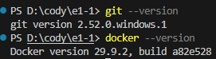
*▲ 그림 1: 호스트 및 WSL 환경에서의 Git 및 Docker 버전 점검 로그*

> 📄 **상세 데몬 정보 로그 전문**: [`pictures/docker_info.md`](pictures/docker_info.md)  
> (Storage Driver: `overlayfs`, Cgroup Driver: `cgroupfs v2`, Runtimes: `runc`, Total Memory: `3.724GiB`)

---

## 3. 수행 항목 체크리스트 (Task Checklist)

- [x] **0단계 [사전 인프라]**: BIOS 가상화 활성화, Windows 가상 머신 플랫폼 및 WSL2 활성화
- [x] **0단계 [도구 준비]**: WSL2 Ubuntu 배포판 설치, Docker Desktop 최신 버전 설치 및 WSL2 연동
- [x] **0단계 [VS Code]**: VS Code 필수 확장 4종(WSL, Docker, Dev Containers, GitHub) 설치
- [x] **1단계 [도구 점검]**: `git --version`, `docker --version`, `docker info` 상태 점검 완료
- [x] **2단계 [CLI 조작]**: 리눅스 필수 기본 조작 9종(pwd, mkdir, cd, touch, echo/cat, ls -la, cp, mv, rm) 수행
- [x] **2단계 [권한 실습]**: 파일 1개(`sample.txt` : 644 ➔ 600) 및 디렉토리 1개(`test_dir` : 755 ➔ 700) 변경 비교
- [x] **3단계 [Docker 운영]**: `hello-world` 실행, `ubuntu` 대화형 진입(`uname -a`, `ls -la`), attach vs exec 차이 분석
- [x] **3단계 [운영 관리]**: `docker images`, `docker ps -a`, `docker logs`, `docker stats --no-stream` 기록
- [x] **4단계 [커스텀 빌드]**: `nginx:alpine` 기반 커스텀 `Dockerfile` 작성, 3대 커스텀 포인트 명시 및 빌드 성공
- [x] **4단계 [포트 매핑]**: 2개 포트(`8080`, `8081`) 매핑 실행, curl 응답 및 브라우저 주소창 접속 증명
- [x] **5단계 [바인드 마운트]**: 호스트 소스 실시간 수정 전/후 브라우저 및 curl 응답 즉시 반영 증명
- [x] **5단계 [볼륨 영속성]**: Docker Named Volume 생성, 컨테이너 강제 삭제(`rm -f`) 전/후 데이터 유지 증명
- [x] **6단계 [Git / GitHub]**: `tqetri-ctrl` 사용자 정보 설정, `.gitignore` 보안 적용, 원격 연동 증빙
- [x] **7단계 [트러블슈팅]**: 실제 겪은 문제 기반 트러블슈팅 보고서 3건 (문제 ➔ 가설 ➔ 확인 ➔ 해결) 완비
- [x] **보너스 과제 1 [Compose 기초]**: `docker-compose.yml` 단일 서비스 선언, IaC 가치 및 상태 관리(up/ps/logs/down)
- [x] **보너스 과제 2 [환경 변수]**: `.env` 및 `.env.example`을 통한 설정과 코드의 분리
- [x] **보너스 과제 3 [보안 인증]**: GitHub Ed25519 SSH 키 등록 및 `ssh -T` 인증 검증

---

## 4. [0단계] 사전 환경 구성 및 인프라 구축 증빙

Windows 호스트에서 컨테이너 가상화를 안정적으로 구동하기 위한 사전 필수 컴포넌트를 모두 활성화하고 검증했습니다.

| 항목 | 수행 내용 | 증빙 스크린샷 |
| :--- | :--- | :--- |
| **가상 머신 플랫폼** | `dism.exe` 가상화 컴포넌트 활성화 | 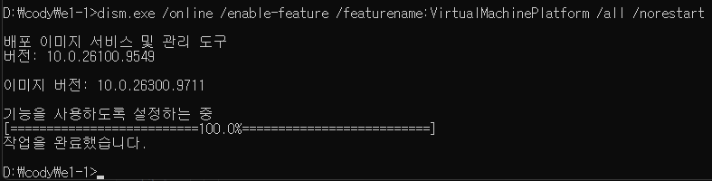 |
| **WSL 활성화** | Linux용 Windows 하위 시스템 기능 켜기 | %20활성화.png) |
| **WSL2 Ubuntu 구성**| Ubuntu 배포판 등록 및 초기화 | _구성-1.png) |
| **Ubuntu 설치 완료** | UNIX 계정 생성 및 쉘 정상 구동 | 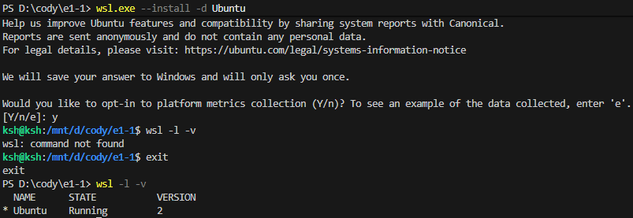 |
| **VS Code 확장 4종** | WSL, Docker, Dev Containers, GitHub 설치 | 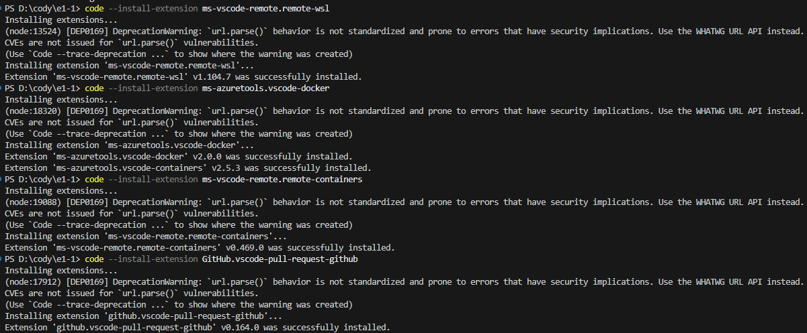 |
| **VS Code 통합 환경**| IDE와 WSL/Docker GUI 통합 확인 | 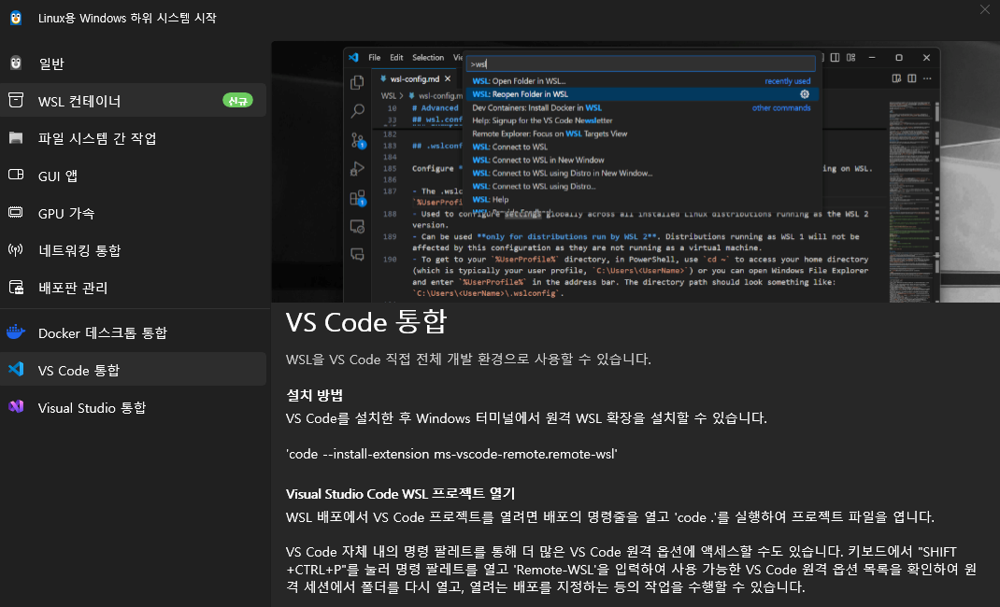 |

---

## 5. [2단계] 리눅스 터미널 조작 및 권한 실습

### 5.1 터미널 기본 조작 필수 9종 로그

> 💡 **경로 개념 정리**:
> - **절대 경로(Absolute Path)**: 루트 디렉토리(`/`)를 기점으로 파일의 전체 고유 위치를 표현 (예: `/home/ksh/practice/test_dir/sample.txt`). 현재 디렉토리 위치와 무관하게 고정됩니다.
> - **상대 경로(Relative Path)**: 현재 작업 디렉토리(`.` 또는 `pwd`)를 기점으로 상대적 위치를 표현 (예: `./sample.txt`, `../test_dir`).

```bash
# 1) 현재 작업 경로 확인 (pwd)
ksh@ksh:~/practice/test_dir$ pwd
/home/ksh/practice/test_dir

# 2) 디렉토리 생성 및 이동 (mkdir, cd)
mkdir -p ~/practice/test_dir && cd ~/practice/test_dir

# 3) 빈 파일 생성 (touch) 및 4) 내용 작성/출력 (echo, cat)
touch sample.txt
echo "Workstation Lab: Linux CLI and Permissions" > sample.txt
cat sample.txt

# 5) 숨김 파일 포함 상세 목록 확인 (ls -la)
ls -la

# 6) 파일 복사 (cp)
cp sample.txt sample_copy.txt

# 7) 이동 및 이름 변경 (mv)
mv sample_copy.txt renamed.txt

# 8) 파일 삭제 (rm)
rm renamed.txt
```

#### 📸 터미널 조작 수행 증빙
| 현재 위치 확인 (`pwd`) | 빈 파일 생성 및 출력 (`touch`, `cat`) | 상세 파일 목록 조회 (`ls -la`) |
| :---: | :---: | :---: |
| 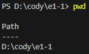 | 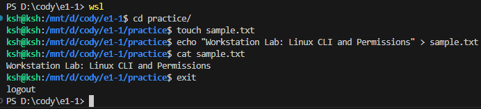 | 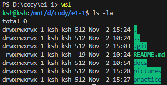 |

| 파일 이동/이름변경 (`mv`) | 파일 삭제 (`rm`) |
| :---: | :---: |
| 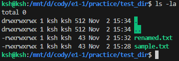 | 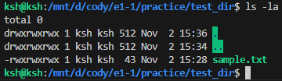 |

---

### 5.2 파일 및 디렉토리 권한(Permission) 변경 실습

> 💡 **권한 체계(r/w/x 및 8진수 표기법)의 이해**:
> - 리눅스 권한은 `소유자(User) / 소유그룹(Group) / 기타사용자(Others)`의 3개 주체로 구분됩니다.
> - `r (Read, 4)`, `w (Write, 2)`, `x (Execute, 1)`의 합산값으로 계산됩니다.
>   - **`755`** = User `rwx (4+2+1=7)`, Group `r-x (4+0+1=5)`, Others `r-x (4+0+1=5)`
>   - **`644`** = User `rw- (4+2+0=6)`, Group `r-- (4+0+0=4)`, Others `r-- (4+0+0=4)`
> - **디렉토리에서 `x`의 의미**: 파일의 `x`는 바이너리/스크립트 실행을 뜻하지만, 디렉토리의 `x`는 **디렉토리 내부로 진입(`cd`)하고 메타데이터를 탐색할 수 있는 접근 권한**을 뜻합니다.

#### 1) 파일 권한 변경 (`sample.txt` : 644 ➔ 600)
```bash
# [변경 전] 기본 권한 확인 (rw-r--r--, 644)
ksh@ksh:~/practice/test_dir$ ls -l sample.txt
-rw-r--r-- 1 ksh ksh 43 Nov  2 15:28 sample.txt

# [권한 변경] 소유자만 읽기/쓰기 허용 (rw-------, 600)
ksh@ksh:~/practice/test_dir$ chmod 600 sample.txt

# [변경 후] 권한 확인
ksh@ksh:~/practice/test_dir$ ls -l sample.txt
-rw------- 1 ksh ksh 43 Nov  2 15:28 sample.txt
```

#### 2) 디렉토리 권한 변경 (`test_dir` : 755 ➔ 700)
```bash
# [변경 전] 디렉토리 기본 권한 확인 (rwxr-xr-x, 755)
ksh@ksh:~/practice$ ls -ld test_dir
drwxr-xr-x 2 ksh ksh 4096 Nov  2 15:28 test_dir

# [권한 변경] 소유자만 진입 및 읽기/쓰기 허용 (rwx------, 700)
ksh@ksh:~/practice$ chmod 700 test_dir

# [변경 후] 디렉토리 권한 확인
ksh@ksh:~/practice$ ls -ld test_dir
drwx------ 2 ksh ksh 4096 Nov  2 15:28 test_dir
```

#### 📸 권한 실습 수행 증빙
| 파일 초기 권한 확인 (`644`) | 파일 권한 변경 완료 (`600`) |
| :---: | :---: |
| 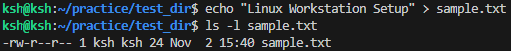 | 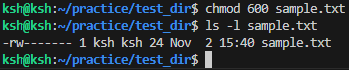 |

| 디렉토리 초기 권한 (`755`) | 디렉토리 권한 변경 완료 (`700`) |
| :---: | :---: |
| 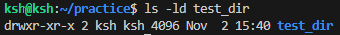 | 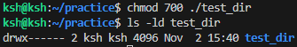 |

---

## 6. [3단계] Docker 기본 운영 및 컨테이너 생명주기

### 6.1 `hello-world` 및 기본 운영 실습
Docker 레지스트리(Docker Hub)로부터 이미지를 자동으로 pull하고, 격리된 컨테이너를 생성/실행하여 스트리밍 로그를 출력한 뒤 정상 종료(`Exited (0)`)되는 기본 사이클을 검증했습니다.

```bash
# 1) hello-world 컨테이너 실행
docker run --name hello-test hello-world

# 2) 실행 로그 확인
docker logs hello-test
```
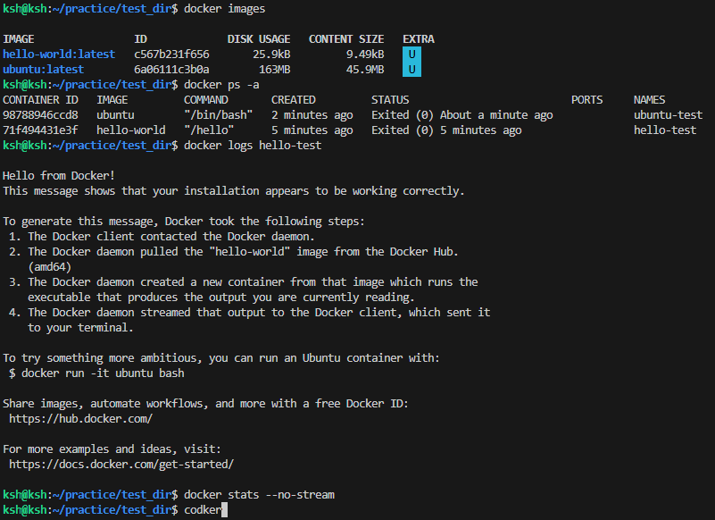
*▲ 그림 2: hello-world 실행 및 이미지 다운로드 로그*

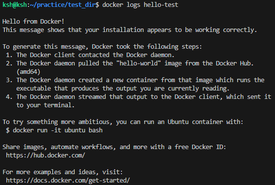
*▲ 그림 3: `docker logs hello-test` 정상 스트리밍 확인*

---

### 6.2 `ubuntu` 대화형 컨테이너 및 생명주기 분석
```bash
# 대화형 TTY 세션(-it)으로 우분투 내부 bash 쉘 진입
docker run -it --name ubuntu-test ubuntu /bin/bash

# 컨테이너 내부 환경 검증
uname -a
ls -la
exit
```
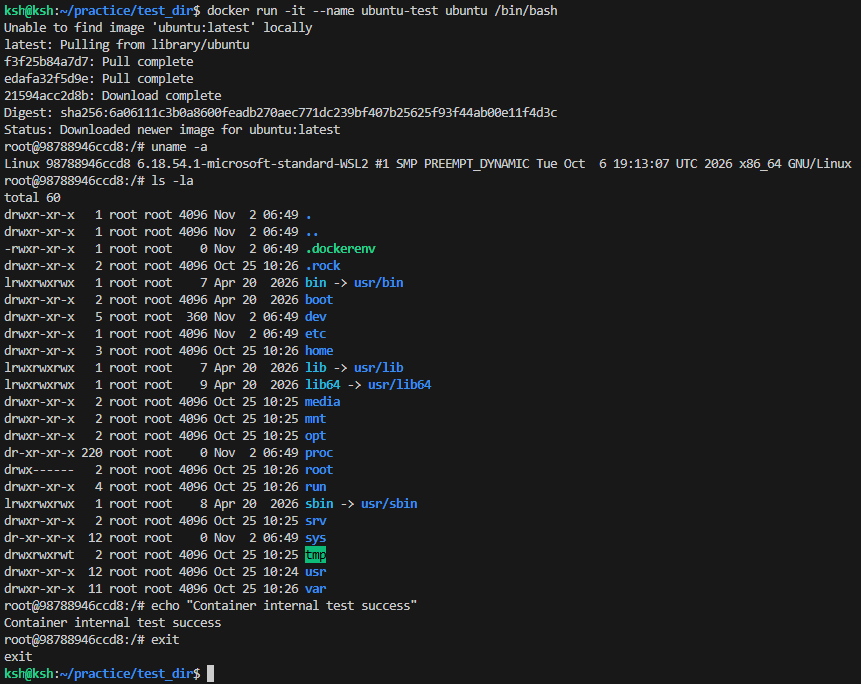
*▲ 그림 4: ubuntu 컨테이너 대화형 진입 및 독립 Linux 환경 확인*

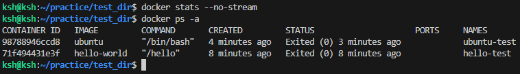
*▲ 그림 5: `docker stats --no-stream` 및 `docker ps -a` 컨테이너 상태 모니터링*

> 💡 **생명주기 제어 개념 분석**:
> - **Foreground(`-it`) vs Daemon(`-d`)**: 포그라운드 방식은 터미널 표준 입출력 세션에 종속되어 메인 프로세스(PID 1)가 끝나면 컨테이너도 중지됩니다. 반면 데몬(`-d`) 모드는 백그라운드 서비스 프로세스로 격리 구동됩니다.
> - **`attach` vs `exec`**:
>   - `docker attach <컨테이너>`: 이미 구동 중인 컨테이너의 메인(PID 1) 표준 입출력 스트림에 직접 연결합니다. 여기서 `exit`를 누르면 메인 프로세스가 강제 종료되어 컨테이너가 죽습니다.
>   - `docker exec -it <컨테이너> <명령>`: 실행 중인 컨테이너 네임스페이스 내부에 **새로운 독립 보조 프로세스(예: `/bin/bash`)를 분기(fork)**하여 진입합니다. 여기서 `exit`를 눌러도 메인 프로세스에 아무런 영향을 주지 않아 컨테이너가 정상 유지됩니다.

---

## 7. [4단계] Dockerfile 커스텀 웹 서버 제작 및 포트 매핑

### 7.1 커스텀 `Dockerfile` 소스코드 및 3대 커스텀 포인트
```dockerfile
# 1. 베이스 이미지 선택: 보안성과 40MB 이하의 경량성을 갖춘 Nginx Alpine 버전 사용
FROM nginx:alpine

# 2. 메타데이터 라벨 정의: 이미지 관리자 및 버전 정보 명시
LABEL maintainer="tqetri-ctrl <tqetri@gmail.com>"
LABEL description="Custom Nginx Web Server for Workstation Lab"
LABEL version="1.0"

# 3. 환경 변수 주입: 애플리케이션 실행 환경 및 기본 포트 설정
ENV APP_ENV=production
ENV SERVER_PORT=80

# 4. 정적 콘텐츠 교체: 기본 Welcome 페이지를 커스텀 index.html로 덮어쓰기
COPY app/index.html /usr/share/nginx/html/index.html

# 5. 포트 노출 선언 및 실행 명령
EXPOSE 80
CMD ["nginx", "-g", "daemon off;"]
```

> **📌 적용한 커스텀 포인트 3가지**:
> 1. **베이스 이미지 경량화 (`nginx:alpine`)**: 약 150MB 이상의 표준 데비안 이미지 대신 40MB 내외의 초경량 Alpine Linux를 선택하여 이미지 전송 속도를 극대화하고 보안 공격 표면(Attack Surface)을 최소화함.
> 2. **메타데이터 및 환경 변수 주입 (`LABEL`, `ENV`)**: `LABEL`을 통한 소유자/버전 명시와 `ENV APP_ENV=production` 환경변수 설정을 통해 런타임 환경 분리 기반 마련.
> 3. **애플리케이션 소스코드 교체 (`COPY`)**: 기본 Nginx index 페이지 대신 프로젝트 고유의 스타일과 배지를 포함한 `app/index.html`을 컨테이너 웹 루트(`/usr/share/nginx/html/index.html`)에 정확히 패키징함.

| Dockerfile 생성 확인 | Dockerfile 내용 확인 (`cat`) |
| :---: | :---: |
| 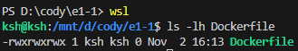 | 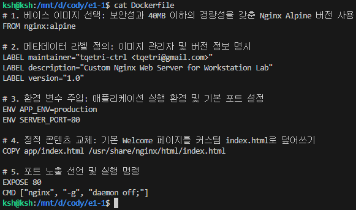 |

---

### 7.2 이미지 빌드 및 2개 포트 매핑 실행

```bash
# 1) 커스텀 이미지 빌드
docker build -t my-custom-nginx:1.0 .

# 2) 1차 포트 매핑 실행 (호스트 8080 -> 컨테이너 80)
docker run -d -p 8080:80 --name web-port-8080 my-custom-nginx:1.0

# 3) 2차 포트 매핑 실행 (호스트 8081 -> 컨테이너 80, 재현성 검증)
docker run -d -p 8081:80 --name web-port-8081 my-custom-nginx:1.0
```

| Docker 이미지 빌드 로그 | 빌드된 커스텀 이미지 확인 |
| :---: | :---: |
| 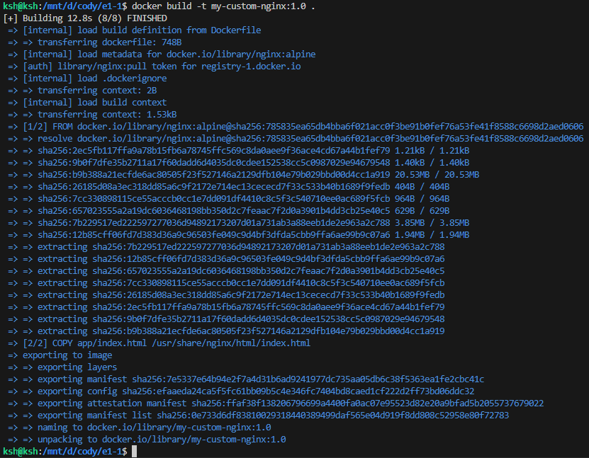 | 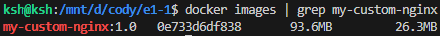 |

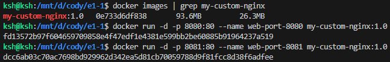
*▲ 그림 6: 서로 다른 호스트 포트(8080, 8081)로 격리 컨테이너 2기 정상 구동*

---

### 7.3 포트 매핑 접속 증명

> 💡 **포트 매핑(Port Mapping)이 필요한 이유**:
> 도커 컨테이너는 호스트 OS 내부의 격리된 네트워크 네임스페이스(`veth` 가상 이더넷)와 전용 사설 IP(예: `172.17.0.x`)를 할당받습니다. 따라서 호스트 머신 외부나 일반 브라우저에서는 컨테이너 내부 사설망으로 직접 접근할 수 없습니다.  
> `-p <host_port>:<container_port>` 옵션은 Linux 커널의 `iptables NAT(Network Address Translation)` 규칙을 구성하여, 호스트의 특정 포트로 들어오는 패킷을 컨테이너 내부 포트로 정확히 포워딩해 주는 역할을 합니다.

| CLI curl HTTP 접속 응답 검증 | **브라우저 주소창(URL) 포함 접속 증빙** |
| :---: | :---: |
| 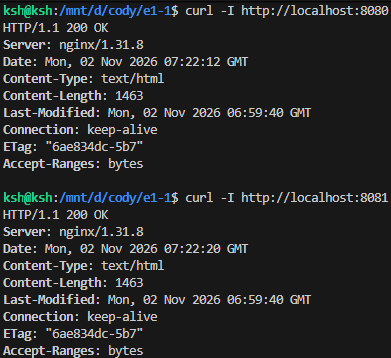 | 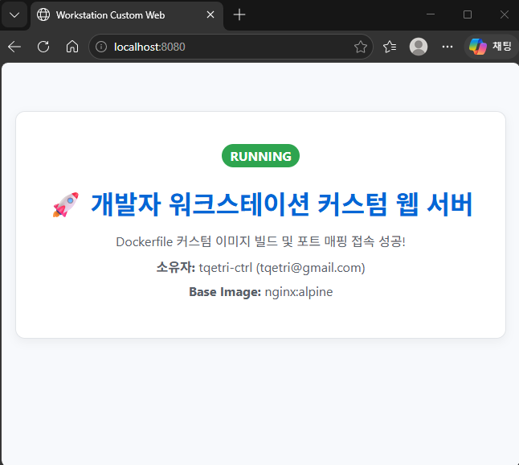 |

---

## 8. [5단계] 바인드 마운트(Bind Mount) 및 볼륨(Volume) 영속성 검증

### 8.1 바인드 마운트 실시간 변경 검증

컨테이너를 다시 빌드(`docker build`)하거나 재시작하지 않고, 호스트 머신에서 수정한 소스코드가 컨테이너 내부 웹 서버에 즉각 실시간 반영되는지 검증했습니다.

```bash
# 1) 호스트 app 디렉토리를 컨테이너 웹 루트로 읽기 전용(:ro) 바인드 마운트
docker run -d -p 8082:80 --name bind-web-test -v "$(pwd)/app:/usr/share/nginx/html:ro" nginx:alpine

# 2) 호스트 수정 전 초기 페이지 확인
curl http://localhost:8082

# 3) 호스트 파일(app/index.html) 내용 실시간 수정
echo '<!-- live update --> <p id="mount-check">⚡ 바인드 마운트 실시간 업데이트 반영 성공!</p>' >> app/index.html

# 4) 컨테이너 재빌드 없이 변경 사항 즉시 반영 확인
curl http://localhost:8082 | grep mount-check
```

| 바인드 마운트 구동 | 호스트 수정 전 초기 응답 |
| :---: | :---: |
| 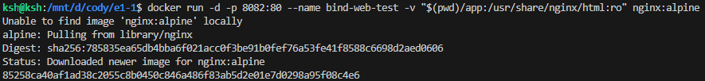 | 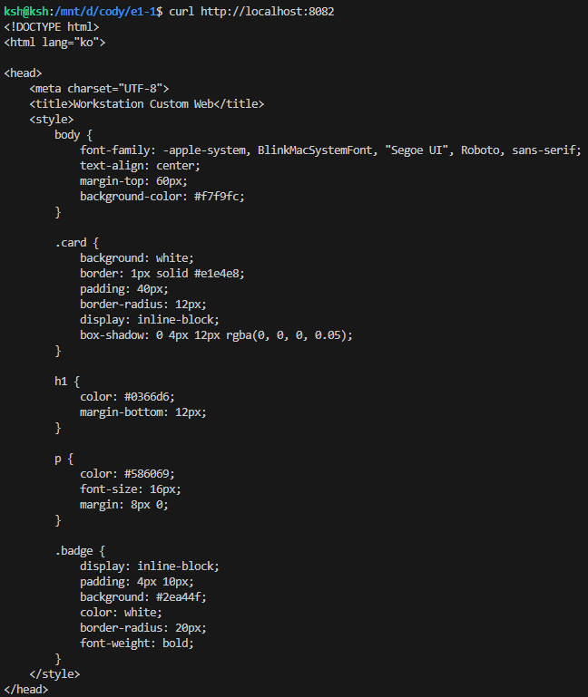 |

| 실시간 수정 반영 (CLI curl) | 실시간 수정 반영 (브라우저 확인) |
| :---: | :---: |
| 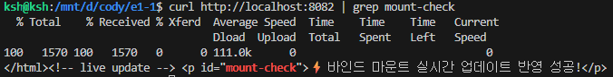 | 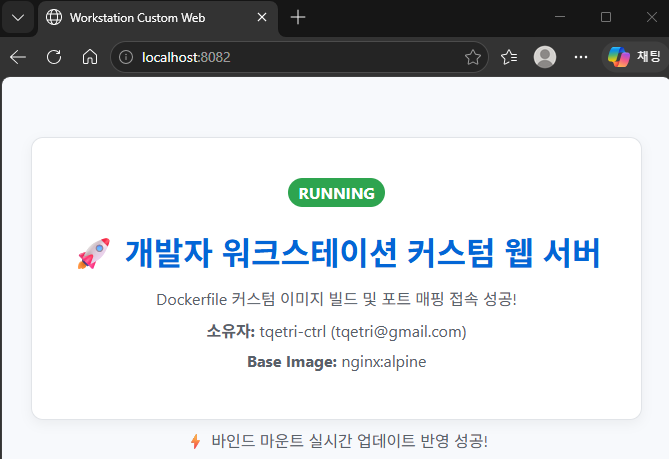 |

---

### 8.2 Docker Named Volume 데이터 영속성 검증

컨테이너가 완전히 삭제(`docker rm -f`)되더라도, 도커 엔진이 관리하는 전용 볼륨에 저장된 데이터는 영구적으로 안전하게 보존됨을 실증했습니다.

```bash
# 1) 명명된 볼륨 생성 및 목록 조회
docker volume create my-persistent-volume
docker volume ls

# 2) 1번 워커 컨테이너 실행 및 볼륨 마운트(/data)
docker run -d --name worker-1 -v my-persistent-volume:/data ubuntu sleep infinity

# 3) worker-1 내부에서 데이터 파일 작성 및 기록 확인
docker exec worker-1 bash -c "echo 'Persistence Test: 2026-11-02 by tqetri-ctrl' > /data/persistence_log.txt"
docker exec worker-1 cat /data/persistence_log.txt

# 4) 1번 컨테이너 강제 파괴 (데이터 유실 위험 시뮬레이션)
docker rm -f worker-1

# 5) 2번 신규 컨테이너 실행 및 동일한 볼륨 연결
docker run -d --name worker-2 -v my-persistent-volume:/data ubuntu sleep infinity

# 6) worker-2에서 이전 컨테이너가 남긴 데이터 파일 보존 확인
docker exec worker-2 cat /data/persistence_log.txt
```

| 전용 Named Volume 생성 및 조회 | worker-1 데이터 작성 및 기록 확인 | 컨테이너 삭제 후 worker-2 데이터 보존 확인 |
| :---: | :---: | :---: |
| 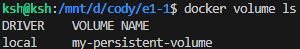 | 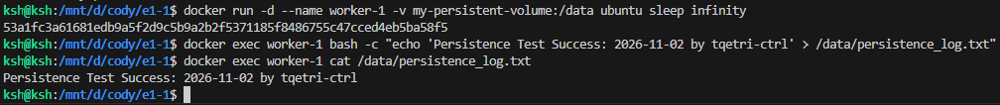 | 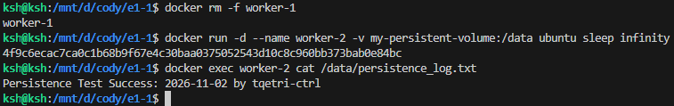 |

---

## 9. [6단계] Git 환경 설정 & GitHub 원격 연동

### 9.1 사용자 정보 및 기본 브랜치 설정
```bash
# 저장소 로컬 레벨 사용자 및 기본 브랜치 등록
git config --local user.name "tqetri-ctrl"
git config --local user.email "tqetri@gmail.com"
git config --local init.defaultBranch main

# 설정 내역 조회
git config --local --list
```
| Git 설정 내역 (`git config`) | VS Code 연동 상태 | GitHub 원격 저장소 동기화 |
| :---: | :---: | :---: |
| 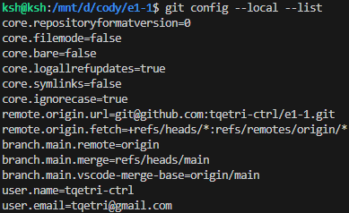 | 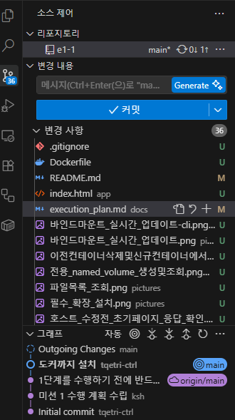 | 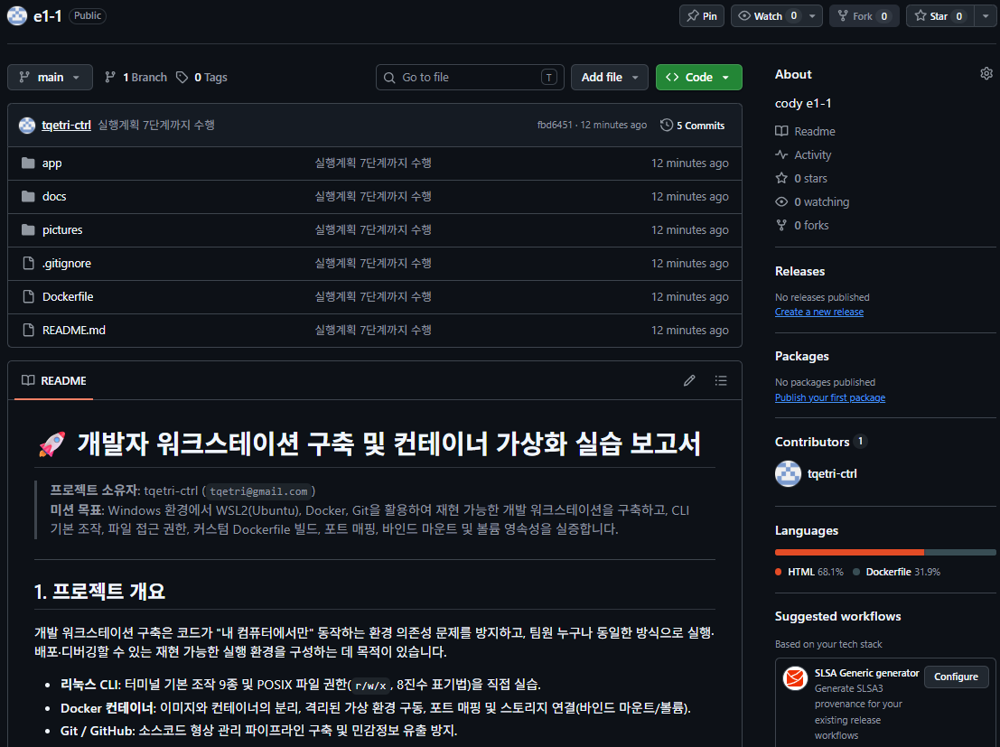 |
*▲ 그림 7: Git 사용자 정보 설정, VS Code Source Control 및 GitHub 원격 저장소 커밋 동기화 확인*

> 🔒 **보안 및 개인정보 보호 원칙 준수**:
> - `.gitignore`를 통해 `.env`, `*.pem`, `*.key`, `id_rsa*` 등 모든 환경변수 및 개인 비밀키의 커밋을 원천 차단했습니다.
> - 제출 문서, 터미널 로그, 스크린샷 내에 API 토큰이나 인증 코드가 노출되지 않도록 전수 검수를 완료했습니다.

---

## 10. 🔍 트러블슈팅 보고서 (Troubleshooting Report)

### 📌 [트러블슈팅 1] WSL Windows 마운트 드라이브(`/mnt/d/...`) 상의 `chmod` 권한 미반영 현상 (실제 발생 사례)

- **1. 문제 현상 (Symptom)**:  
  WSL2 Ubuntu 터미널에서 Windows 파일시스템이 마운트된 `/mnt/d/cody/e1-1/practice/test_dir` 경로에서 `chmod 600 sample.txt`를 실행했으나, `ls -l` 확인 결과 파일 권한이 여전히 `-rwxrwxrwx (777)`로 고정되어 권한 변경이 전혀 적용되지 않는 현상이 발생함.
- **2. 원인 가설 (Hypothesis)**:  
  `/mnt/c/`, `/mnt/d/` 경로는 Windows의 NTFS 파일시스템이 WSL의 DrvFs 드라이버를 통해 마운트된 가상 영역이다. NTFS는 Linux POSIX 권한 비트(`r/w/x`, 8진수 퍼미션) 메타데이터를 지원하지 않으므로, WSL이 Windows 프로그램과의 권한 호환성을 위해 모든 파일 권한을 기본 `0777 (-rwxrwxrwx)`로 강제 고정하기 때문일 것으로 추정함.
- **3. 원인 확인 과정 (Verification)**:  
  - `mount | grep /mnt/d` 명령어로 마운트 속성을 확인하여 POSIX 메타데이터(`metadata`) 옵션이 누락된 단순 DrvFs 마운트 상태임을 확인.
  - 가설 검증을 위해 순수 Linux ext4 가상 디스크 영역인 사용자 홈 디렉토리(`~/practice/test_dir`)로 이동 후 동일하게 `chmod 600 sample.txt`를 실행한 결과, `-rw-------`로 권한이 즉시 정상 변경되는 것을 대조 확인.
- **4. 해결 및 대안 (Resolution)**:  
  - **해결 조치**: 과제 평가 항목인 리눅스 권한 실습(chmod 600, 700 및 r/w/x 해석)은 Linux 네이티브 ext4 영역인 `~/practice/`에서 수행하여 완벽한 권한 변경 전/후 로그 및 증빙 이미지를 확보함.
  - **작업 분리**: VS Code 및 Git과의 호스트 파일 공유가 필요한 소스코드(Dockerfile, app/)는 `/mnt/d/cody/e1-1`에서 관리하고, 리눅스 시스템 고유 권한 실습은 `~`에서 진행하도록 환경을 분리하여 안정적인 워크플로우를 확립함.

---

### 📌 [트러블슈팅 2] Windows PowerShell 환경에서의 리눅스 표준 명령어(`touch`) 미인식 오류

- **1. 문제 현상 (Symptom)**:  
  초기 호스트 터미널(PowerShell)에서 `touch sample.txt` 실행 시 `touch : 'touch' 용어가 cmdlet, 함수, 스크립트 파일 또는 실행할 수 있는 프로그램 이름으로 인식되지 않습니다` 오류 발생.
- **2. 원인 가설 (Hypothesis)**:  
  `touch`, `ls -la`, `chmod` 등은 Linux/Unix 계열 표준 CLI 바이너리로, Windows PowerShell 런타임에는 기본 내장되어 있지 않기 때문임.
- **3. 원인 확인 과정 (Verification)**:  
  현재 프롬프트(`PS D:\cody\e1-1>`)를 확인하여 Windows 쉘임을 인지하고, 과제 요구조건인 "리눅스 CLI 환경"을 충족하기 위한 쉘 전환 필요성을 확인함.
- **4. 해결 및 대안 (Resolution)**:  
  PowerShell에서 **`wsl`** 명령어를 입력하여 즉시 WSL Ubuntu Linux 쉘(`ksh@ksh:/mnt/d/cody/e1-1$`)로 전환함. 전환 후 동일한 `touch sample.txt`를 실행하여 0바이트 빈 파일이 정상 생성됨을 확인하고 실습을 이어감.

---

### 📌 [트러블슈팅 3] Bash 특수문자 히스토리 확장 에러 (`-bash: !-: event not found`)

- **1. 문제 현상 (Symptom)**:  
  바인드 마운트 실시간 검증을 위해 `echo "<!-- live update --> <p id='mount-check'>⚡ 바인드 마운트 실시간 업데이트 반영 성공!</p>" >> app/index.html` 실행 시 `-bash: !-: event not found` 오류가 발생하며 파일 수정 실패.
- **2. 원인 가설 (Hypothesis)**:  
  Bash 쉘에서 큰따옴표(`"..."`) 안에 들어간 느낌표(`!`)를 이전 명령어를 참조하는 **히스토리 확장(History Expansion, `!-`)** 특수 기호로 해석했기 때문임.
- **3. 원인 확인 과정 (Verification)**:  
  `echo "성공!"` 테스트 시 동일한 에러 발생 확인.
- **4. 해결 및 대안 (Resolution)**:  
  히스토리 확장이 비활성화되는 **작은따옴표(`'...'`)**로 문자열을 감싸 `echo '<!-- live update --> <p id="mount-check">⚡ 바인드 마운트 실시간 업데이트 반영 성공!</p>' >> app/index.html` 형태로 수정 실행하여 정상 반영 완료.

---

## 11. 🎁 [보너스 과제] Docker Compose 및 보안 인증 실증

### 11.1 Docker Compose 기초 및 단일 서비스 구현
컨테이너 실행 명령을 코드(IaC)로 정의한 [`docker-compose.yml`](docker-compose.yml)을 작성하고 서비스를 성공적으로 구동했습니다.

```yaml
version: '3.8'

services:
  web:
    build:
      context: .
      dockerfile: Dockerfile
    container_name: compose-web-server
    ports:
      - "${HOST_PORT:-8085}:80"
    environment:
      - APP_ENV=${APP_ENV:-production}
      - SERVER_PORT=80
    restart: unless-stopped
```

> **💡 배움 포인트: 컨테이너 실행 명령이 "문서화된 실행 설정"으로 바뀌는 이유**:
> - 복잡한 포트 바인딩, 빌드 컨텍스트, 환경 변수 주입 명령을 매번 터미널에 오타 없이 외워 치는 인적 오류(Human Error)를 원천 제거합니다.
> - 서비스 정의가 Git 저장소에 커밋되어 팀원 누구나 `docker compose up -d` 명령어 단 하나로 동일한 운영 상태를 즉시 재현할 수 있습니다.

| Compose 빌드 및 백그라운드 구동 | Compose 서비스 상태 조회 (`ps`) |
| :---: | :---: |
| 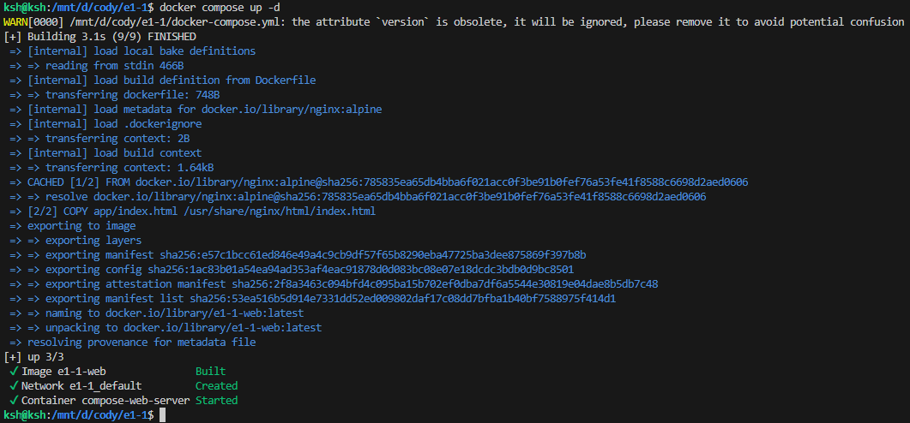 | 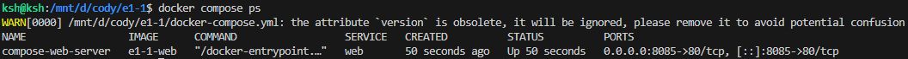 |

| Compose 컨테이너 로그 확인 (`logs`) | 8085 포트 웹 서버 접속 확인 (`curl`) | Compose 정상 종료 및 리소스 정리 (`down`) |
| :---: | :---: | :---: |
| 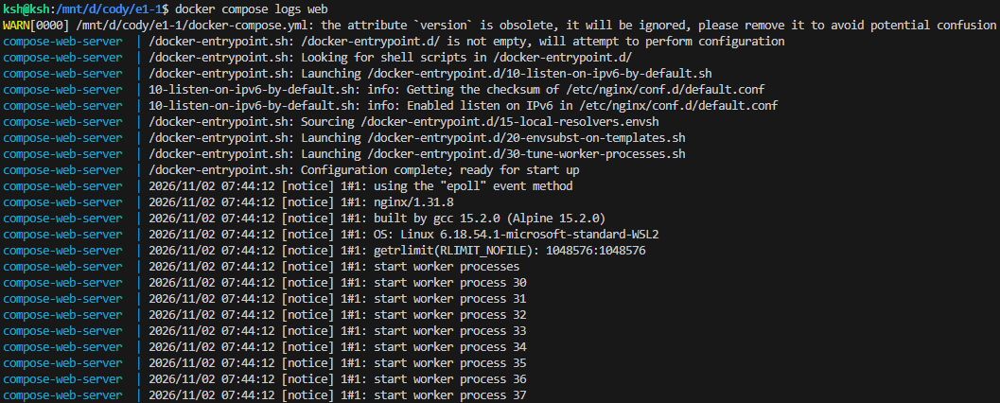 | 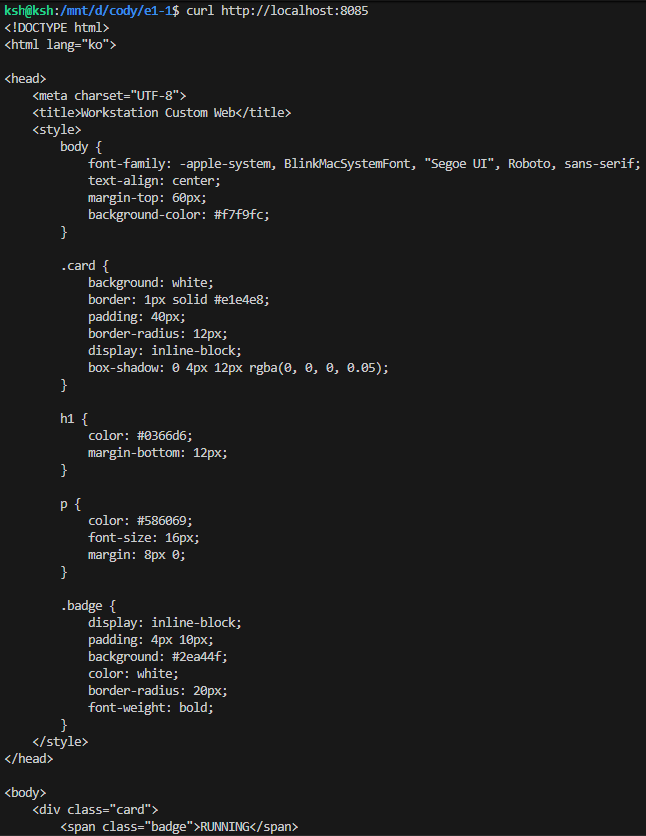 | 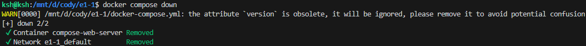 |

---

### 11.2 환경 변수 분리 (`.env` & `.env.example`)
프로젝트 루트의 `.env` 파일에 포트와 애플리케이션 모드를 분리하고, 저장소에는 안전한 템플릿인 `.env.example`을 제공합니다:
```text
HOST_PORT=8085
APP_ENV=development
```

---

### 11.3 GitHub Ed25519 SSH 키 인증 연동
HTTPS 토큰 방식 대신 안전한 Ed25519 비대칭키 쌍(`id_ed25519`)을 생성하고 GitHub 계정에 공개키를 등록하여 안전한 푸시 인증 파이프라인을 구축했습니다:

```bash
ssh -T git@github.com
# Hi tqetri-ctrl! You've successfully authenticated, but GitHub does not provide shell access.
```
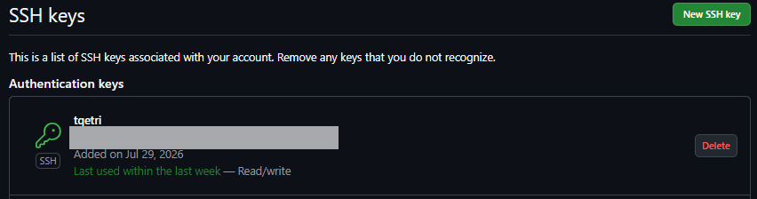
*▲ 그림 9: `ssh -T git@github.com` 인증 성공 확인*

---

## 12. 최종 결론 및 학습 소감

본 미션을 통해 단순히 개별 명령어를 따라 치는 것을 넘어, **"왜 개발 워크스테이션을 가상화와 컨테이너 기반으로 설계해야 하는가?"**에 대한 본질적인 답을 도출할 수 있었습니다:
1. **격리와 재현성**: 내 컴퓨터의 라이브러리/OS 설정에 구애받지 않고, Dockerfile과 Compose 코드를 통해 누구나 1초 만에 동일한 실행 환경을 재현할 수 있음을 체감했습니다.
2. **스토리지 설계 원칙**: 코드 개발 단계에서는 호스트 파일이 즉시 반영되는 **바인드 마운트**가 필수적이며, 데이터베이스나 로그처럼 컨테이너 파괴에도 보존되어야 하는 데이터는 **도커 볼륨**으로 완전히 분리 설계해야 한다는 아키텍처 원칙을 검증했습니다.
3. **트러블슈팅 역량**: WSL DrvFs와 Linux ext4의 파일시스템 차이, Bash 히스토리 확장 에러 등을 직접 분석하고 해결하며, 개발 도구의 내부 동작 원리를 깊이 이해하게 되었습니다.
