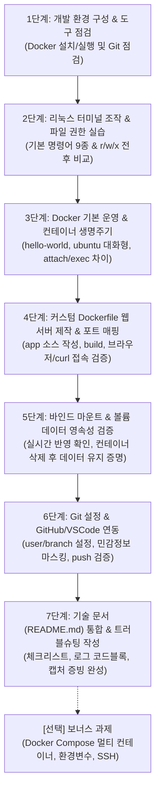

# 워크스테이션 환경 구축 미션 단계별 상세 수행 계획서 (Execution Plan)

> **문서 목적**: `docs/mission.md`의 모든 요구사항(필수 및 보너스 과제)을 누락 없이 100% 달성하기 위한 구체적인 절차, 수행 방법(명령어, Docker 설정 등), 증빙 자료 수집 기준 및 트러블슈팅 가이드를 제공합니다.

---

## 1. 개요 및 전체 워크플로우



---

## 2. 단계별 상세 수행 계획 및 매뉴얼

### [1단계] 개발 환경 구성 및 도구 점검
- **목표**: 터미널 환경 확인, Docker 데몬 구동 및 필수 도구 버전 점검.
- **수행 방법**:
  1. **Docker 실행 환경 세팅 (OS 및 권한 환경별)**
     - **Windows 환경 (Docker Desktop)**:
       - Docker Desktop 실행 후 시스템 트레이에서 정상 구동(Engine running) 상태 확인.
       - WSL2 백엔드가 활성화되어 있는지 확인 (Settings > General > Use the WSL 2 based engine).
     - **서울 캠퍼스 정책 환경 (sudo 권한 제한 시)**:
       - **OrbStack** 실행 (OrbStack이 백그라운드에서 Docker 엔진을 구동하여 sudo 권한 없이도 `docker` CLI 사용 가능).
  2. **환경 점검 명령어 실행**:
     ```bash
     # Git 버전 확인
     git --version

     # Docker 클라이언트 및 서버 버전 확인
     docker --version

     # Docker 데몬 동작 상태 점검
     docker info
     ```
- **수집 증빙 자료**:
  - `git --version`, `docker --version`, `docker info` 실행 출력 로그 (코드 블록).

---

### [2단계] 리눅스 터미널 조작 및 파일 권한 실습
- **목표**: 필수 터미널 명령어 9종을 실행하고, 파일 1개 및 디렉토리 1개의 권한 변경(chmod) 전/후 결과를 수집한다.
- **수행 방법**:
  1. **터미널 기본 조작 9종 실습**:
     ```bash
     # 1) 현재 작업 디렉토리 확인
     pwd

     # 2) 디렉토리 생성
     mkdir -p ./practice/test_dir

     # 3) 디렉토리 이동
     cd ./practice

     # 4) 빈 파일 생성
     touch sample.txt

     # 5) 파일 내용 작성 및 확인
     echo "Linux Workstation Setup" > sample.txt
     cat sample.txt

     # 6) 목록 확인 (숨김 파일 포함)
     ls -la

     # 7) 파일 복사
     cp sample.txt sample_copy.txt

     # 8) 파일 이동 및 이름 변경
     mv sample_copy.txt renamed.txt

     # 9) 파일 삭제
     rm renamed.txt
     ```
  2. **권한(Permission) 변경 실습 (파일 1개, 디렉토리 1개)**:
     - **이론 정리**:
       - `r`(Read: 4), `w`(Write: 2), `x`(Execute: 1).
       - 표기법: 소유자(User) / 소유그룹(Group) / 기타사용자(Others).
       - `755` = rwxr-xr-x, `644` = rw-r--r--.
     - **파일 권한 변경**:
       ```bash
       # 변경 전 확인
       ls -l sample.txt
       # 권한 변경 (644 -> 600: 소유자만 읽기/쓰기 가능)
       chmod 600 sample.txt
       # 변경 후 확인
       ls -l sample.txt
       ```
     - **디렉토리 권한 변경**:
       ```bash
       # 변경 전 확인
       ls -ld test_dir
       # 권한 변경 (755 -> 700: 소유자만 진입 및 목록 조회 가능)
       chmod 700 test_dir
       # 변경 후 확인
       ls -ld test_dir
       ```
- **수집 증빙 자료**:
  - 터미널 조작 전체 명령어 및 출력 로그.
  - 파일 및 디렉토리 권한 변경 전/후 `ls -l` 비교 출력.

---

### [3단계] Docker 기본 운영 및 컨테이너 생명주기 실습
- **목표**: `hello-world`, `ubuntu` 컨테이너 실행을 통해 이미지/컨테이너 분리 및 생명주기를 파악한다.
- **수행 방법**:
  1. **hello-world 실행**:
     ```bash
     docker run --name hello-test hello-world
     ```
  2. **ubuntu 대화형 컨테이너 진입 및 내부 명령 수행**:
     ```bash
     # 대화형 터미널(-it)로 ubuntu 컨테이너 진입
     docker run -it --name ubuntu-test ubuntu /bin/bash

     # 컨테이너 내부 프롬프트에서 실행
     uname -a
     ls -la
     echo "Container internal test"
     exit
     ```
  3. **Docker 운영 관리 명령 실행**:
     ```bash
     # 이미지 목록 확인
     docker images

     # 종료된 컨테이너 포함 전체 목록 확인
     docker ps -a

     # 특정 컨테이너 로그 확인
     docker logs hello-test

     # 실시간 리소스 사용량 1회 스냅샷 확인
     docker stats --no-stream
     ```
  4. **생명주기 및 개념 분석 정리**:
     - **Foreground(`-it`) vs Daemon(`-d`)**: 포그라운드는 터미널 입출력을 직접 차지하며 프로세스 종료 시 컨테이너도 중지됨. 백그라운드 데몬은 백그라운드 프로세스로 동작.
     - **컨테이너 탈출 방식**: `exit` 입력 시 메인 프로세스가 종료되어 컨테이너가 `Exited` 상태가 됨. `Ctrl + P, Q` 사용 시 컨테이너를 실행 상태(`Up`)로 유지한 채 빠져나옴.
     - **attach vs exec**: `docker attach`는 컨테이너의 메인(1번) 프로세스 표준 입출력에 접속. `docker exec -it`는 실행 중인 컨테이너 내부에 새로운 보조 프로세스(예: `/bin/bash`)를 생성하여 진입.

---

### [4단계] 기존 베이스 기반 커스텀 Dockerfile 웹 서버 제작 및 포트 매핑
- **목표**: Nginx 베이스의 커스텀 웹 서버를 직접 빌드하고, 포트 매핑을 통해 브라우저 접속을 입증한다.
- **수행 방법**:
  1. **웹 소스코드 및 커스텀 Dockerfile 준비**:
     - 경로 구조:
       ```text
       e1-1/
       ├── Dockerfile
       └── app/
           └── index.html
       ```
     - `app/index.html` 작성:
       ```html
       <!DOCTYPE html>
       <html lang="ko">
       <head>
           <meta charset="UTF-8">
           <title>Workstation Web Server</title>
           <style>
               body { font-family: sans-serif; text-align: center; margin-top: 50px; }
               .card { border: 1px solid #ddd; padding: 20px; border-radius: 8px; display: inline-block; }
           </style>
       </head>
       <body>
           <div class="card">
               <h1>🚀 개발자 워크스테이션 웹 서버</h1>
               <p>Dockerfile 커스텀 이미지 빌드 및 포트 매핑 성공!</p>
               <p>환경: Nginx on Alpine Linux</p>
           </div>
       </body>
       </html>
       ```
     - `Dockerfile` 작성:
       ```dockerfile
       # 1. 기존 베이스 이미지 선택 (경량 Alpine Linux 기반 Nginx)
       FROM nginx:alpine

       # 2. 메타데이터 라벨 정의
       LABEL maintainer="student"
       LABEL description="Custom Nginx Web Server for Workstation Lab"

       # 3. 환경 변수 주입
       ENV APP_ENV=production
       ENV PORT=80

       # 4. 정적 웹 콘텐츠 교체
       COPY app/index.html /usr/share/nginx/html/index.html

       # 5. 포트 노출 선언 및 실행 명령
       EXPOSE 80
       CMD ["nginx", "-g", "daemon off;"]
       ```
     - **커스텀 포인트 3가지 명시**:
       1. 베이스 이미지: 보안성과 경량화(약 40MB)를 갖춘 `nginx:alpine` 선택.
       2. 환경변수/라벨: `LABEL`을 통한 이미지 버전 관리 및 `ENV APP_ENV=production` 환경 분리.
       3. 정적 콘텐츠 교체: 기본 Nginx 환영 페이지 대신 커스텀 `index.html` 복사.
  2. **이미지 빌드 및 컨테이너 실행**:
     ```bash
     # 커스텀 이미지 빌드
     docker build -t my-custom-nginx:1.0 .

     # 빌드된 이미지 확인
     docker images | grep my-custom-nginx

     # 포트 매핑 (호스트 8080 -> 컨테이너 80) 실행
     docker run -d -p 8080:80 --name custom-web-8080 my-custom-nginx:1.0

     # 2회차 포트 매핑 (호스트 8081 -> 컨테이너 80) 실행
     docker run -d -p 8081:80 --name custom-web-8081 my-custom-nginx:1.0
     ```
  3. **접속 검증**:
     ```bash
     # CLI 접속 확인
     curl http://localhost:8080
     curl http://localhost:8081
     ```
- **수집 증빙 자료**:
  - `docker build` 및 `docker run` 실행 로그.
  - 웹 브라우저 접속 화면 캡처: **주소창(`http://localhost:8080`)과 웹페이지 내용이 모두 보이는 스크린샷**.
  - 포트 매핑이 필요한 이유(호스트 격리 네트워크 환경과 NAT/포트 포워딩 원리) 서술.

---

### [5단계] 바인드 마운트(Bind Mount) & 볼륨(Volume) 영속성 검증
- **목표**: 컨테이너의 휘발성 파일시스템 한계를 극복하는 두 가지 스토리지 방식을 실증한다.
- **수행 방법**:
  1. **바인드 마운트 실시간 변경 검증**:
     ```bash
     # 호스트의 현재 디렉토리 ./app을 컨테이너의 웹 루트로 마운트
     docker run -d -p 8082:80 --name bind-web -v "$(pwd)/app:/usr/share/nginx/html:ro" nginx:alpine

     # 1차 접속 확인
     curl http://localhost:8082

     # 호스트에서 index.html 내용 실시간 수정
     echo "<!-- updated --> <p>⚡ 바인드 마운트 실시간 반영 완료!</p>" >> app/index.html

     # 컨테이너 재빌드/재시작 없이 즉시 변경되었는지 확인
     curl http://localhost:8082
     ```
     - 증빙: 호스트 파일 수정 전/후 `curl` 응답 비교 로그.

  2. **Docker 볼륨 영속성 검증**:
     ```bash
     # 1) Docker 전용 Named 볼륨 생성
     docker volume create my-persistent-volume
     docker volume ls

     # 2) 첫 번째 컨테이너에 볼륨 연결 및 데이터 작성
     docker run -d --name vol-worker-1 -v my-persistent-volume:/data ubuntu sleep infinity
     docker exec vol-worker-1 bash -c "echo 'Persisted Data: 2026-11-02' > /data/persistence_check.txt"
     docker exec vol-worker-1 cat /data/persistence_check.txt

     # 3) 첫 번째 컨테이너 강제 삭제 (데이터 유실 여부 검증)
     docker rm -f vol-worker-1

     # 4) 두 번째 신규 컨테이너 생성 후 동일 볼륨 마운트
     docker run -d --name vol-worker-2 -v my-persistent-volume:/data ubuntu sleep infinity

     # 5) 삭제된 컨테이너가 작성했던 데이터가 유지되었는지 검증
     docker exec vol-worker-2 cat /data/persistence_check.txt
     ```
     - 증빙: 볼륨 생성 ➔ 데이터 작성 ➔ 컨테이너 삭제 ➔ 새 컨테이너에서 데이터 조회 성공 로그.

---

### [6단계] Git 설정 및 GitHub / VSCode 연동
- **목표**: 로컬 Git 기본 정보 설정, 안전한 `.gitignore` 구성, GitHub 원격 연동 증빙을 확보한다.
- **수행 방법**:
  1. **Git 설정**:
     ```bash
     git config --global user.name "<사용자명>"
     git config --global user.email "<이메일>"
     git config --global init.defaultBranch main
     git config --list
     ```
  2. **민감정보 보호 (`.gitignore`)**:
     - `.env`, 개인키(`*.pem`, `id_rsa`), OS 캐시(`Thumbs.db`, `.DS_Store`) 등을 포함하여 작성.
  3. **GitHub 원격 저장소 푸시 및 연동**:
     ```bash
     git add .
     git commit -m "feat: complete developer workstation setup and verification"
     git branch -M main
     git remote add origin <GitHub_Repository_URL>
     git push -u origin main
     ```
- **수집 증빙 자료**:
  - `git config --list` 터미널 출력 (비밀번호나 토큰 마스킹).
  - VSCode GitHub 로그인 연동 상태 또는 브라우저의 GitHub 레포지토리 커밋 히스토리 캡처.

---

### [7단계] 기술 문서(`README.md`) 통합 및 트러블슈팅 정리
- **목표**: 평가자가 README 하나만으로도 모든 수행 내용과 검증 결과를 파악할 수 있도록 완성한다.
- **README.md 필수 포함 섹션 구성**:
  1. **프로젝트 개요**: 미션 목표 및 목적 요약.
  2. **실행 환경**: OS, Shell, Docker 버전, Git 버전 명시.
  3. **수행 항목 체크리스트**: 전체 미션 체크박스.
  4. **터미널 및 권한 실습 로그**: 9종 명령어 로그 + 755/644 설명 + 변경 전/후 `ls -l`.
  5. **Docker 기본 운영 로그**: `docker info`, `hello-world`, `ubuntu`, `ps -a`, `logs`, `stats`.
  6. **Dockerfile 커스텀 웹 서버**: Dockerfile 코드, 커스텀 포인트 설명, 빌드 로그, 브라우저 캡처 링크.
  7. **바인드 마운트 및 볼륨 영속성**: 변경 전/후 비교 로그, 볼륨 보존 검증 로그.
  8. **Git & GitHub 연동 증빙**: `git config` 출력 및 연동 스크린샷.
  9. **트러블슈팅 보고서 (최소 2건)**:
     - **트러블슈팅 #1: 포트 바인딩 충돌 (`bind: address already in use`)**
       - **문제 현상**: `docker run -p 8080:80 ...` 실행 시 포트 충돌 오류 발생.
       - **원인 가설**: 호스트 시스템에서 다른 웹 서버 또는 이전 실습 컨테이너가 8080 포트를 점유 중.
       - **확인 과정**: `docker ps` 및 `netstat`으로 8080 포트 점유 프로세스 확인.
       - **해결/대안**: 미사용 컨테이너를 `docker stop`으로 중지하거나, 호스트 포트를 `8081` 등 사용 가능한 포트로 변경 매핑.
     - **트러블슈팅 #2: 바인드 마운트 시 운영체제 간 경로 구분자 인식 오류**
       - **문제 현상**: Windows PowerShell에서 `$(pwd)` 또는 상대 경로 마운트 시 경로가 올바르게 전달되지 않거나 마운트 실패.
       - **원인 가설**: Windows 역슬래시(`\`)와 POSIX 슬래시(`/`) 표현 방식 차이로 컨테이너 내부 파싱 실패.
       - **확인 과정**: 컨테이너 내부 `ls /usr/share/nginx/html` 실행 시 빈 디렉토리로 마운트된 것 확인.
       - **해결/대안**: 절대 경로를 POSIX 표준 슬래시(`/d/cody/e1-1/app`)로 변환하거나 PowerShell 표준 `${PWD}` 환경변수 형식 적용.

---

## 3. [선택] 보너스 과제 실행 계획

1. **Docker Compose 기초 & 멀티 컨테이너 (`docker-compose.yml`)**:
   - Web(Nginx) + App(또는 Redis) 2개 서비스를 하나의 컴포즈 파일로 정의.
   - 컨테이너 간 동일 네트워크(`app-net`)를 통해 서비스명으로 통신하는지 검증.
   - `docker compose up -d`, `docker compose ps`, `docker compose logs`, `docker compose down` 관리 로그 기록.
2. **환경 변수 분리 (`.env`)**:
   - `HOST_PORT=8080`, `APP_ENV=production`을 `.env`에 정의하고 Compose 파일에서 `${HOST_PORT}`로 주입.
3. **GitHub SSH 키 설정**:
   - `ssh-keygen -t ed25519 -C "user@email.com"` 생성.
   - GitHub Settings > SSH Keys에 공개키 등록 후 `ssh -T git@github.com` 연결 검증.

---

## 4. 최종 누락 방지 점검표 (Checklist)

| 구분 | 필수 요구 항목 | 포함 여부 | 비고 |
| :--- | :--- | :---: | :--- |
| **문서** | 프로젝트 개요 & 실행 환경(OS, Docker, Git 버전) | [ ] | README.md 상단 |
| **문서** | 수행 항목 체크리스트 | [ ] | 테이블/체크박스 |
| **터미널** | 현재위치, 목록(숨김포함), 이동, 생성, 복사, 이름변경, 삭제, 내용확인, 빈파일 | [ ] | 9종 명령어 로그 |
| **권한** | 파일 1개, 디렉토리 1개 권한 변경 전/후 비교 (`ls -l`) | [ ] | r/w/x 및 755/644 설명 |
| **Docker** | 버전(`--version`) 및 데몬 동작(`info`) 확인 | [ ] |  |
| **Docker** | 이미지/컨테이너 운영 명령 (`images`, `ps -a`, `logs`, `stats`) | [ ] |  |
| **Docker** | `hello-world` 및 `ubuntu` 대화형 실행, attach/exec 차이 정리 | [ ] |  |
| **Dockerfile** | 커스텀 Dockerfile 작성 및 3가지 커스텀 포인트 명시 | [ ] | 코드블록 포함 |
| **포트 매핑** | 포트 매핑 실행 및 브라우저 주소창 포함 접속 스크린샷 | [ ] | curl 로그 병행 |
| **스토리지** | 바인드 마운트 호스트 변경 전/후 실시간 반영 증명 | [ ] |  |
| **스토리지** | Docker 볼륨 생성, 컨테이너 삭제 전/후 데이터 유지 증명 | [ ] |  |
| **Git** | 사용자 정보 설정 (`git config --list`), GitHub 연동 증빙 | [ ] | 민감정보 마스킹 |
| **트러블** | 트러블슈팅 최소 2건 (문제 -> 가설 -> 확인 -> 해결) | [ ] |  |
| **제약사항** | GitHub 공개 저장소 링크로 제출 가능 구성 | [ ] |  |

