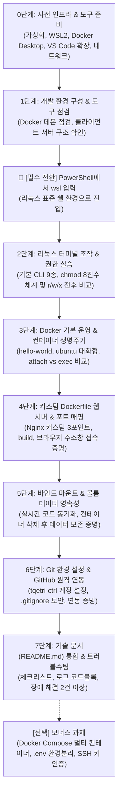

# 워크스테이션 환경 구축 미션 단계별 상세 수행 계획서 (Execution Plan)

> **문서 목적**: `docs/mission.md`의 모든 요구사항(필수 및 보너스 과제)을 누락 없이 100% 달성하기 위해, 각 단계별 **활동의 목적(Why)**과 **상세 수행 가이드(How)**, **수집 증빙 자료(Artifacts)** 및 **트러블슈팅 가이드**를 체계적으로 제공합니다.

---

## 1. 개요 및 전체 워크플로우



---

## 2. 단계별 상세 수행 계획 및 매뉴얼

---

### [0단계] 사전 환경 구성 및 필수 의존성 세팅 (Prerequisites & Base Setup)

#### 📌 활동 목적
Windows 호스트 환경에서 컨테이너 가상화와 Linux CLI를 원활하게 구동하기 위한 하드웨어, 운영체제, 네트워크 및 개발 도구 인프라를 빈틈없이 사전 구축합니다.

#### 🛠️ 상세 수행 가이드

1. **하드웨어 가상화(Virtualization) 활성화**
   - **목적**: WSL2 가상 머신 및 Docker 엔진(하이퍼바이저 경량 VM)이 구동되기 위한 CPU 레벨 가상화 기능을 켭니다.
   - **수행 방법**:
     - `Ctrl + Shift + Esc` (작업 관리자) ➔ [성능] 탭 ➔ [CPU] ➔ 우측 하단 **가상화: 사용(Enabled)** 확인.
     - *미사용 상태인 경우*: PC 재부팅 후 BIOS/UEFI(부팅 시 F2 또는 Del)로 진입하여 `Intel Virtualization Technology (VT-x)` 또는 `AMD SVM Mode`를 `Enabled`로 설정하고 저장.

2. **Windows 가상화 컴포넌트(VirtualMachinePlatform & WSL) 활성화**
   - **목적**: 윈도우 OS 커널 레벨에서 Linux 하위 시스템과 가상 머신 플랫폼을 구동할 수 있도록 활성화합니다.
   - **수행 방법** (PowerShell 관리자 권한 실행):
     ```powershell
     # 가상 머신 플랫폼 및 WSL 기능 활성화
     dism.exe /online /enable-feature /featurename:VirtualMachinePlatform /all /norestart
     dism.exe /online /enable-feature /featurename:Microsoft-Windows-Subsystem-Linux /all /norestart
     ```
   - 시스템 재부팅 안내가 나오면 재부팅을 진행합니다.

3. **WSL2 설치 및 Ubuntu 배포판 등록**
   - **목적**: 리눅스 표준 터미널 환경을 호스트 머신에 구축합니다.
   - **수행 방법**:
     ```powershell
     # WSL2 커널 업데이트 및 기본 버전 2 설정
     wsl --update
     wsl --set-default-version 2

     # Ubuntu 배포판 설치
     wsl.exe --install -d Ubuntu
     ```
   - 설치 완료 후 자동으로 뜨는 터미널(또는 시작 메뉴의 Ubuntu 앱)에서 초기 UNIX 사용자 계정(`username`)과 비밀번호를 생성합니다.
   - 정상 설치 확인: `wsl -l -v` 실행 시 `Ubuntu`가 보이고 `VERSION`이 `2`인지 확인.

4. **Docker 런타임 설치 및 환경 설정 (최신 Docker Desktop 기준)**
   - **목적**: 컨테이너 이미지를 빌드하고 실행하기 위한 Docker 엔진(Daemon)을 호스트 및 WSL에 연동합니다.
   - **수행 방법**:
     - 공식 웹사이트에서 `Docker Desktop Installer.exe` (x86_64/AMD64용) 다운로드 후 설치.
     - 설치 옵션에서 "Use recommended settings" 또는 "Use WSL 2 instead of Hyper-V" 기본 선택 유지.
     - Docker Desktop 실행 후 시스템 트레이의 고래 아이콘이 **초록색 Engine running**인지 확인.
     - 상단 톱니바퀴 **[Settings] ➔ [Resources] ➔ [WSL integration]**으로 이동:
       - ① `Enable integration with my default WSL distro` 체크 확인.
       - ② 하단 `Ubuntu` 토글 스위치를 **ON (파란색)**으로 활성화.
       - ③ 우측 하단 **[Apply & restart]** 클릭.
     - *서울 캠퍼스 정책(sudo 제약) 환경인 경우*: 미션 지침에 따라 **OrbStack**을 설치하여 일반 사용자 권한으로 Docker 소켓을 구동합니다.
    - **환경 변수 설정**:
      - $env:Path += ";Docker Desktop.exe파일 위치"

5. **터미널 & IDE(VS Code) 개발 도구 구성 및 필수 확장 설치**
   - **목적**: 코드 작성, 컨테이너 시각화 관리, 리눅스 원격 개발을 하나의 통합 환경에서 수행합니다.
   - **수행 방법 (원클릭 CLI 설치)**:
     PowerShell에서 아래 명령어를 실행하여 필수 확장 4종을 일괄 설치합니다:
     ```powershell
     code --install-extension ms-vscode-remote.remote-wsl
     code --install-extension ms-azuretools.vscode-docker
     code --install-extension ms-vscode-remote.remote-containers
     code --install-extension GitHub.vscode-pull-request-github
     ```
   - 설치 확인: `code --list-extensions` 입력 후 4개 확장 목록 확인.

6. **네트워크 및 방화벽 사전 점검**
   - **목적**: 컨테이너의 포트 매핑(8080, 8081 등)이 Windows 방화벽에 차단되거나, Docker Hub 이미지 다운로드(`docker pull`)가 DNS 오류로 실패하는 문제를 사전에 예방합니다.
   - **수행 방법**:
     - **방화벽 인바운드 허용**: Docker Desktop 최초 실행 또는 컨테이너 실행 시 Windows 보안 경고 팝업이 뜨면 **"개인 네트워크(홈 또는 회사 네트워크)"**를 반드시 체크하고 **[액세스 허용]**을 클릭합니다.
     - **포트 점유 사전 점검**: 실습에 사용할 포트가 다른 프로그램(IIS, 다른 웹 서버 등)에 의해 사용 중인지 확인합니다.
       ```powershell
       netstat -ano | findstr :8080
       netstat -ano | findstr :8081
       # 아무 출력도 없으면 해당 포트를 바로 사용 가능합니다.
       ```
     - **DNS 및 Docker Hub 통신 점검**: 사내망이나 특수 VPN 환경에서 `docker pull` 실패 시, Docker Desktop의 [Settings] ➔ [Docker Engine]의 JSON 설정에 DNS를 명시합니다:
       ```json
       {
         "dns": ["8.8.8.8", "1.1.1.1"]
       }
       ```

---

### [1단계] 개발 환경 구성 및 도구 점검

#### 📌 활동 목적
Docker 클라이언트(CLI)와 Docker 서버(데몬 프로세스) 간의 소켓 통신이 정상적으로 체결되었는지 확인하고, 실습에 사용될 OS/Shell/Git/Docker의 전체 환경 정보를 기록하여 재현 가능한 기술 문서의 기초를 마련합니다.

#### 🛠️ 상세 수행 가이드
1. **버전 및 상태 점검 명령어 순차 실행**:
   ```bash
   # 1) Git 버전 확인
   git --version

   # 2) Docker 클라이언트/서버 버전 확인
   docker --version

   # 3) Docker 데몬 상세 상태(CPU, 메모리, 런타임 드라이버 등) 확인
   docker info
   ```
2. **이상 징후 점검 포인트**:
   - `docker info` 실행 시 `Cannot connect to the Docker daemon` 에러가 발생하면 Docker Desktop이 꺼져 있거나 WSL 연동이 비활성화된 상태이므로 Docker Desktop을 재시작합니다.

#### 📸 수집 증빙 자료 및 체크포인트
- `git --version`, `docker --version`, `docker info` 실행 전체 출력 텍스트 로그.
- README.md의 `실행 환경` 섹션에 OS(Windows 10/11, Ubuntu WSL2), Shell(PowerShell / bash), Docker 버전, Git 버전을 표 형태로 기재.

---

### 🔄 [필수 실습 전환] Windows PowerShell에서 WSL 리눅스 터미널로 진입하기

> ⚠️ **매우 중요 (오류 방지)**:
> Windows 기본 PowerShell에서는 `touch`, `ls -la`, `chmod` 같은 리눅스 표준 명령어가 지원되지 않아 **`touch : 'touch' 용어가 cmdlet...으로 인식되지 않습니다`** 오류가 발생합니다.
> 또한, 이번 미션의 **권한 실습(r/w/x, 755/644, chmod)**은 반드시 **리눅스 OS 환경**에서만 정상 동작합니다.
> 따라서 **2단계(터미널 및 권한 실습)부터는 반드시 아래 가이드에 따라 WSL 리눅스 쉘로 전환한 후 명령어를 실행**해야 합니다.

#### 🔹 1. WSL 리눅스 쉘 진입 방법 (택 1)
- **방법 A (현재 PowerShell 창에서 즉시 전환)**:
  PowerShell 프롬프트(`PS D:\cody\e1-1>`)에서 아래 명령어를 입력하고 Enter를 누릅니다:
  ```powershell
  wsl
  ```
- **방법 B (VS Code 통합 터미널에서 WSL 열기)**:
  1. `Ctrl + ~` (백틱) 키를 눌러 하단 터미널을 엽니다.
  2. 터미널 우측 상단의 `+` 옆 화살표(▼) 클릭 ➔ **`Ubuntu (WSL)`**을 선택하여 새 탭을 엽니다.

#### 🔹 2. 리눅스 환경 진입 성공 확인 (프롬프트 변화)
- 진입 전 (Windows PowerShell):
  ```powershell
  PS D:\cody\e1-1>
  ```
- **진입 후 (WSL Ubuntu Linux 쉘)**:
  ```bash
  username@DESKTOP-NAME:/mnt/d/cody/e1-1$
  ```
  *(초록색 텍스트 프롬프트로 바뀌고, 현재 작업 디렉토리 `D:\cody\e1-1`이 리눅스 마운트 경로인 `/mnt/d/cody/e1-1`로 자동 연결됩니다.)*

#### 🔹 3. 리눅스 쉘 종료 및 윈도우 복귀 방법
- 실습 후 다시 Windows PowerShell로 돌아오고 싶을 때는 언제든지 아래 명령어를 입력합니다:
  ```bash
  exit
  ```

---

### [2단계] 리눅스 터미널 기본 조작 및 파일 권한 실습

#### 📌 활동 목적
Linux 파일 시스템의 절대 경로/상대 경로 메커니즘을 이해하고, 파일 및 디렉토리의 접근 제어 권한 체계(`r/w/x`, 8진수 표기법 `755`, `644`)를 직접 변경·검증함으로써 컨테이너 볼륨 마운트 시 흔히 발생하는 권한 문제를 스스로 진단할 수 있는 기초 역량을 확보합니다.

> 💡 **실행 환경**: 위에서 설명한 **WSL Ubuntu 쉘(`username@...:/mnt/d/cody/e1-1$`)** 상태에서 아래 명령어를 차례대로 실행합니다.

#### 🛠️ 상세 수행 가이드

1. **터미널 기본 조작 필수 9종 실습**:
   실습 전용 디렉토리(`practice`)를 생성하여 아래 명령어를 차례대로 수행합니다:
   ```bash
   # 1) 현재 작업 위치 확인 (리눅스 절대 경로: /mnt/d/cody/e1-1/practice)
   pwd

   # 2) 실습용 디렉토리 생성 (-p 옵션으로 부모 디렉토리 포함 생성)
   mkdir -p ./practice/test_dir

   # 3) 디렉토리 이동 (상대 경로 이동)
   cd ./practice

   # 4) 빈 파일 생성 (리눅스 touch 명령어로 0바이트 파일 생성)
   touch sample.txt

   # 5) 파일 내용 작성 및 터미널 출력 확인
   echo "Workstation Lab: Linux CLI and Permissions" > sample.txt
   cat sample.txt

   # 6) 숨김 파일(.) 및 상세 권한을 포함한 목록 조회
   ls -la

   # 7) 파일 복사 (원본 보존)
   cp sample.txt sample_copy.txt

   # 8) 파일 이동 및 이름 변경
   mv sample_copy.txt renamed.txt

   # 9) 파일 삭제
   rm renamed.txt
   ```

2. **권한(Permission) 변경 실습 (파일 1개, 디렉토리 1개)**:
   - **권한 체계의 이해**:
     - `r`(Read, 4), `w`(Write, 2), `x`(Execute, 1)의 조합으로 소유자(User) / 소유그룹(Group) / 기타사용자(Others)의 3자리 8진수로 표현.
     - **파일에서의 `x`**: 실행 파일(스크립트/바이너리)로 실행할 수 있는 권한.
     - **디렉토리에서의 `x`**: 디렉토리 내부로 진입(`cd`)하고 메타데이터에 접근할 수 있는 권한.
   
   > ⚠️ **[핵심 대처 방안] `/mnt/...` (Windows DrvFs) 경로의 chmod 무시 현상 해결**:
   > - **문제 현상**: `/mnt/d/cody/e1-1/...` 경로에서 `chmod 600` 또는 `chmod 755`를 실행해도 `ls -l` 결과가 여전히 `-rwxrwxrwx`로 변경되지 않습니다.
   > - **원인**: Windows의 NTFS 파일 시스템은 Linux POSIX 권한 비트를 지원하지 않아, WSL이 호환성을 위해 권한을 `777`로 강제 고정하기 때문입니다.
   > - **대처 방안**: 권한 실습은 **순수 Linux 파일 시스템(ext4)** 영역인 **홈 디렉토리(`~` 또는 `/home/username/practice`)**로 이동하여 수행합니다!

   - **홈 디렉토리 이동 및 권한 변경 실습 명령어**:
     ```bash
     # 1) 순수 리눅스 홈 디렉토리로 이동하여 실습 폴더 생성
     cd ~
     mkdir -p practice/test_dir
     cd practice/test_dir
     echo "Workstation Lab: Permissions" > sample.txt

     # 2) 파일 권한 변경 실습 (sample.txt)
     # 변경 전 권한 확인 (기본값: -rw-r--r--, 644)
     ls -l sample.txt
     # 권한 변경: 소유자만 읽기/쓰기 가능, 기타 사용자 접근 차단 (600)
     chmod 600 sample.txt
     # 변경 후 권한 확인 (-rw-------) -> 정상 변경 확인!
     ls -l sample.txt

     # 추가 실습: 755 권한 부여
     chmod 755 sample.txt
     # 변경 후 권한 확인 (-rwxr-xr-x)
     ls -l sample.txt

     # 3) 디렉토리 권한 변경 실습 (test_dir)
     # 변경 전 디렉토리 권한 확인 (기본값: rwxr-xr-x, 755)
     ls -ld ../test_dir
     # 권한 변경: 소유자만 읽기/쓰기/진입 가능 (700)
     chmod 700 ../test_dir
     # 변경 후 디렉토리 권한 확인 (rwx------) -> 정상 변경 확인!
     ls -ld ../test_dir
     ```

#### 📸 수집 증빙 자료 및 체크포인트
- 터미널 조작 9종의 입력 명령어와 출력 결과 전문(터미널 복사 로그).
- 파일 1개 및 디렉토리 1개의 권한 변경 전/후 `ls -l` 및 `ls -ld` 비교 코드 블록.
- 절대 경로와 상대 경로의 차이 및 755/644 숫자의 계산 규칙 설명 텍스트 작성.

---

### [3단계] Docker 기본 운영 및 컨테이너 생명주기 실습

#### 📌 활동 목적
"불변의 템플릿인 이미지"와 "격리된 상태를 가진 컨테이너"의 차이를 이해하고, 대화형/백그라운드 실행 방식과 컨테이너 유지/종료 메커니즘(`attach` vs `exec`, `exit` vs `Ctrl+P,Q`)을 체득합니다.

#### 🛠️ 상세 수행 가이드

1. **hello-world 검증**:
   - 로컬에 이미지가 없을 때 레지스트리(Docker Hub)에서 자동 pull하고 컨테이너를 생성/실행한 뒤 종료하는 기본 동작 과정을 관찰합니다:
     ```bash
     docker run --name hello-test hello-world
     ```

2. **ubuntu 대화형 컨테이너 진입 및 내부 조작**:
   - Ubuntu 경량 이미지 위에서 독립된 Linux 파일 시스템을 체험합니다:
     ```bash
     # -i(interactive)와 -t(pseudo-TTY) 옵션으로 표준 입출력을 터미널에 연결
     docker run -it --name ubuntu-test ubuntu /bin/bash

     # 컨테이너 내부 쉘(root@...:/#)에서 실행
     uname -a
     ls -la
     echo "Container internal test success"

     # 컨테이너 종료하며 탈출
     exit
     ```

3. **Docker 운영 관리 명령어 세트 수행**:
   ```bash
   # 1) 로컬 이미지 목록 확인
   docker images

   # 2) 종료된 컨테이너를 포함한 전체 상태 확인
   docker ps -a

   # 3) hello-test 컨테이너의 표준 출력 로그 조회
   docker logs hello-test

   # 4) 컨테이너의 CPU/메모리/네트워크 실시간 사용량 1회 스냅샷 확인
   docker stats --no-stream
   ```

4. **생명주기 및 제어 개념 정리 (기술 문서용)**:
   - **Foreground(`-it`) vs Daemon(`-d`)**: 포그라운드는 콘솔 세션에 묶여 메인 프로세스 종료 시 컨테이너도 함께 정지됨. 데몬 모드는 백그라운드 서비스 형태로 실행.
   - **`attach` vs `exec`**:
     - `docker attach <컨테이너>`: 이미 실행 중인 컨테이너의 메인(PID 1) 프로세스의 표준 입출력에 직접 연결. 여기서 `exit`를 누르면 메인 프로세스가 죽어 컨테이너가 중지됨.
     - `docker exec -it <컨테이너> <명령>`: 실행 중인 컨테이너 내부에 새로운 보조 프로세스(예: `/bin/bash`)를 별도로 실행하여 진입. 여기서 `exit`를 입력해도 메인 프로세스는 계속 살아있음.

#### 📸 수집 증빙 자료 및 체크포인트
- `hello-world` 실행 로그 전체.
- `ubuntu` 컨테이너 내부 실행 명령 및 출력 화면.
- `docker images`, `docker ps -a`, `docker logs`, `docker stats` 실행 텍스트 로그.

---

### [4단계] 커스텀 Dockerfile 웹 서버 제작 및 포트 매핑

#### 📌 활동 목적
기존의 오픈소스 웹 서버(Nginx) 베이스 이미지에 커스텀 소스코드와 환경설정을 주입하여 완전히 새로운 커스텀 이미지를 빌드하고, 컨테이너의 격리된 네트워크 포트를 호스트 포트와 연결(NAT/포트 포워딩)하여 실제 브라우저 접속을 성립시킵니다.

#### 🛠️ 상세 수행 가이드

1. **프로젝트 루트로 이동 및 정적 웹페이지 준비**:
   - **경로 확인**: 반드시 프로젝트 루트 디렉토리(`d:\cody\e1-1` 또는 WSL 경로 `/mnt/d/cody/e1-1`)에서 진행합니다.
   - **CLI 명령어로 `app/index.html` 생성**:
     ```bash
     # 1) 프로젝트 루트로 이동
     cd /mnt/d/cody/e1-1

     # 2) app 디렉토리 생성
     mkdir -p app

     # 3) app/index.html 파일 생성 및 내용 작성
     cat << 'EOF' > app/index.html
     <!DOCTYPE html>
     <html lang="ko">
     <head>
         <meta charset="UTF-8">
         <title>Workstation Custom Web</title>
         <style>
             body { font-family: -apple-system, BlinkMacSystemFont, "Segoe UI", Roboto, sans-serif; text-align: center; margin-top: 60px; background-color: #f7f9fc; }
             .card { background: white; border: 1px solid #e1e4e8; padding: 40px; border-radius: 12px; display: inline-block; box-shadow: 0 4px 12px rgba(0,0,0,0.05); }
             h1 { color: #0366d6; margin-bottom: 12px; }
             p { color: #586069; font-size: 16px; margin: 8px 0; }
             .badge { display: inline-block; padding: 4px 10px; background: #2ea44f; color: white; border-radius: 20px; font-weight: bold; }
         </style>
     </head>
     <body>
         <div class="card">
             <span class="badge">RUNNING</span>
             <h1>🚀 개발자 워크스테이션 커스텀 웹 서버</h1>
             <p>Dockerfile 커스텀 이미지 빌드 및 포트 매핑 접속 성공!</p>
             <p><strong>소유자:</strong> tqetri-ctrl (tqetri@gmail.com)</p>
             <p><strong>Base Image:</strong> nginx:alpine</p>
         </div>
     </body>
     </html>
     EOF

     # 4) 생성 확인
     cat app/index.html
     ```

2. **커스텀 Dockerfile 작성 (`Dockerfile`) 상세 가이드**:
   > ⚠️ **주의사항**: 파일 이름은 확장자 없이 반드시 첫 글자가 대문자인 **`Dockerfile`**이어야 합니다 (`dockerfile.txt` 등으로 생성되지 않도록 주의).

   #### 🔹 방법 A: 터미널 한 줄 명령어로 자동 생성 (가장 추천)
   WSL 터미널(또는 PowerShell)에서 프로젝트 루트(`d:\cody\e1-1`)에 위치한 상태로 아래 블록 전체를 복사·붙여넣기하여 실행합니다:
   ```bash
   cat << 'EOF' > Dockerfile
   # 1. 베이스 이미지 선택: 보안성과 40MB 이하의 경량성을 갖춘 Nginx Alpine 버전 사용
   FROM nginx:alpine

   # 2. 메타데이터 라벨 정의: 이미지 관리자 및 버전 정보 명시
   LABEL maintainer="tqetri-ctrl <tqetri@gmail.com>"
   LABEL description="Custom Nginx Web Server for Workstation Lab"
   LABEL version="1.0"

   # 3. 환경 변수 주입: 애플리케이션 실행 환경 및 기본 포트 설정
   ENV APP_ENV=production
   ENV SERVER_PORT=80

   # 4. 정적 콘텐츠 교체: 기본 Welcome 페이지를 커스텀 index.html로 덮어쓰기
   COPY app/index.html /usr/share/nginx/html/index.html

   # 5. 포트 노출 선언 및 실행 명령
   EXPOSE 80
   CMD ["nginx", "-g", "daemon off;"]
   EOF
   ```

   #### 🔹 방법 B: VS Code 에디터로 직접 파일 생성 및 편집
   1. 터미널에서 아래 명령어로 VS Code에서 `Dockerfile`을 직접 엽니다:
      ```bash
      code Dockerfile
      ```
      *(또는 VS Code 좌측 탐색기 빈 공간 우클릭 ➔ [New File(새 파일)] ➔ 파일명 `Dockerfile` 입력)*
   2. 열린 편집기 창에 위의 Dockerfile 내용을 붙여넣고 저장(`Ctrl + S`)합니다.

   #### 🔹 생성 검증 명령어
   정상적으로 생성되었는지 파일 목록과 내용을 확인합니다:
   ```bash
   # 파일 존재 및 크기 확인
   ls -lh Dockerfile

   # 작성된 내용 출력 확인
   cat Dockerfile
   ```

3. **내가 적용한 커스텀 포인트 3가지 정리**:
   - **포인트 1 (베이스 이미지 경량화)**: 기본 debian 기반 nginx 대신 경량 alpine 리눅스(`nginx:alpine`)를 선택하여 빌드 속도 향상 및 보안 취약점 최소화.
   - **포인트 2 (환경변수 및 라벨 메타데이터)**: `LABEL`을 통한 소유자 및 버전 명시와 `ENV APP_ENV=production` 환경변수 분리.
   - **포인트 3 (정적 소스 교체)**: `COPY` 지시어로 커스텀 웹 페이지를 Nginx 기본 서빙 경로에 정확히 배치.

4. **이미지 빌드 및 2개 포트 매핑 실행**:
   ```bash
   # 커스텀 이미지 빌드
   docker build -t my-custom-nginx:1.0 .

   # 빌드된 이미지 확인
   docker images | grep my-custom-nginx

   # 1차 실행: 호스트 8080 포트를 컨테이너 80 포트로 매핑
   docker run -d -p 8080:80 --name web-port-8080 my-custom-nginx:1.0

   # 2차 실행: 호스트 8081 포트를 컨테이너 80 포트로 매핑 (재현성 검증)
   docker run -d -p 8081:80 --name web-port-8081 my-custom-nginx:1.0
   ```

5. **접속 검증 (CLI & 웹 브라우저)**:
   ```bash
   # CLI에서 HTTP 상태 및 응답 확인
   curl -I http://localhost:8080
   curl -I http://localhost:8081
   ```
   - **웹 브라우저 접속 검증**: 웹 브라우저(Chrome/Edge)를 열고 `http://localhost:8080` 및 `http://localhost:8081`에 직접 접속합니다.

#### 📸 수집 증빙 자료 및 체크포인트
- `docker build` 출력 전체 텍스트 로그.
- `docker ps` 상태 출력 로그.
- **웹 브라우저 접속 스크린샷 필수**: 주소창의 URL(`http://localhost:8080`)과 웹페이지 내용이 선명하게 포함된 화면 캡처 이미지.
- 포트 매핑이 필요한 이유(호스트와 격리된 컨테이너의 가상 veth 인터페이스 및 iptables NAT 포워딩 원리) 서술.

---

### [5단계] 바인드 마운트(Bind Mount) & 볼륨(Volume) 영속성 검증

#### 📌 활동 목적
컨테이너의 쓰기 가능 계층(Writable Layer)이 컨테이너 삭제와 함께 모두 사라지는 "휘발성" 문제를 극복하기 위해, **로컬 소스코드 실시간 동기화(바인드 마운트)**와 **독립적인 데이터 영구 저장소(Docker Named Volume)**의 차이와 동작 방식을 명확히 증명합니다.

#### 🛠️ 상세 수행 가이드

1. **바인드 마운트(Bind Mount) 실시간 반영 검증**:
   호스트의 `./app` 디렉토리를 컨테이너의 웹 서빙 경로에 연결하여, 컨테이너 재빌드 없이 호스트 파일 수정이 즉시 반영되는지 확인합니다:
   ```bash
   # 1) 현재 작업 디렉토리의 app 폴더를 컨테이너 /usr/share/nginx/html 로 읽기 전용(:ro) 마운트
   docker run -d -p 8082:80 --name bind-web-test -v "$(pwd)/app:/usr/share/nginx/html:ro" nginx:alpine

   # 2) 호스트 수정 전 초기 페이지 응답 확인
   curl http://localhost:8082

   # 3) 호스트의 index.html 파일 내용을 실시간으로 수정 (문구 추가, 작은따옴표 사용으로 bash 히스토리 확장 에러 방지)
   echo '<!-- live update --> <p id="mount-check">⚡ 바인드 마운트 실시간 업데이트 반영 성공!</p>' >> app/index.html

   # 4) 컨테이너 재시작이나 재빌드 없이 바로 변경 사항이 반영되었는지 확인
   curl http://localhost:8082 | grep mount-check
   ```

2. **Docker 볼륨(Volume) 영속성 검증 (컨테이너 삭제 전/후 비교)**:
   Docker 엔진이 호스트 파일시스템의 격리된 영역에서 직접 관리하는 독립 볼륨을 생성하여, 컨테이너가 파괴되어도 데이터가 유지됨을 증명합니다:
   ```bash
   # 1) 전용 Named Volume 생성 및 조회
   docker volume create my-persistent-volume
   docker volume ls

   # 2) 첫 번째 컨테이너(worker-1) 생성 및 볼륨 /data 마운트
   docker run -d --name worker-1 -v my-persistent-volume:/data ubuntu sleep infinity

   # 3) worker-1 내부에서 영속 테스트용 데이터 파일 작성
   docker exec worker-1 bash -c "echo 'Persistence Test Success: 2026-11-02 by tqetri-ctrl' > /data/persistence_log.txt"

   # 4) 데이터 정상 기록 확인 (컨테이너 삭제 전 상태)
   docker exec worker-1 cat /data/persistence_log.txt

   # 5) worker-1 컨테이너를 강제 삭제 (컨테이너 파괴)
   docker rm -f worker-1

   # 6) 두 번째 신규 컨테이너(worker-2)를 생성하고 동일한 볼륨 마운트
   docker run -d --name worker-2 -v my-persistent-volume:/data ubuntu sleep infinity

   # 7) worker-2에서 이전 컨테이너가 작성했던 데이터가 그대로 보존되었는지 검증
   docker exec worker-2 cat /data/persistence_log.txt
   ```

#### 📸 수집 증빙 자료 및 체크포인트
- 바인드 마운트: 호스트 파일 수정 전과 수정 후의 `curl` 응답 비교 텍스트 로그.
- 볼륨 영속성: 볼륨 생성 ➔ worker-1 데이터 작성 ➔ worker-1 강제 삭제 ➔ worker-2 데이터 조회 결과가 연결된 전체 터미널 출력 로그.

---

### [6단계] Git 환경 설정 & GitHub / VSCode 원격 연동

#### 📌 활동 목적
버전 관리 도구인 Git의 로컬 형상 관리 파이프라인과 원격 협업 플랫폼인 GitHub의 연동 구조를 완성하고, `.gitignore`를 통해 비밀번호, API 토큰 등 민감정보의 외부 유출을 원천적으로 차단합니다.

#### 🛠️ 상세 수행 가이드

1. **Git 로컬 환경 설정**:
   현재 프로젝트 저장소에 사용자 정보와 기본 브랜치를 설정합니다:
   ```bash
   # 저장소 로컬 레벨 사용자 정보 등록
   git config --local user.name "tqetri-ctrl"
   git config --local user.email "tqetri@gmail.com"
   git config --local init.defaultBranch main

   # 설정 내역 확인
   git config --local --list
   ```

2. **민감정보 보호를 위한 `.gitignore` 작성**:
   프로젝트 루트에 `.gitignore` 파일을 작성하여 불필요하거나 위험한 파일이 커밋되지 않도록 합니다:
   ```gitignore
   # 운영체제 캐시 및 메타데이터
   Thumbs.db
   ehthumbs.db
   Desktop.ini
   .DS_Store

   # IDE 및 에디터 설정
   .vscode/*
   !.vscode/settings.json
   .idea/

   # 보안 및 환경 변수 파일 (절대 커밋 금지)
   .env
   .env.*
   *.pem
   *.key
   id_rsa*

   # 임시 로그 및 빌드 부산물
   *.log
   temp/
   practice/
   ```

3. **원격 저장소 연동 및 변경사항 푸시**:
   ```bash
   # 변경사항 스테이징 및 커밋
   git add .
   git commit -m "feat: complete developer workstation setup, docker lab, and documentation"

   # 원격 저장소 푸시
   git push -u origin main
   ```

4. **VS Code GitHub 연동**:
   - VS Code 좌측 하단의 **계정(사람 모양) 아이콘** 클릭 ➔ **Sign in with GitHub** 선택.
   - 브라우저 인증 창에서 `tqetri-ctrl` 계정으로 로그인 및 승인.

#### 📸 수집 증빙 자료 및 체크포인트
- `git config --local --list` 출력 로그 (개인 액세스 토큰이나 비밀번호가 없는지 확인 후 마스킹).
- VS Code 좌측 Source Control 탭의 연동 상태 또는 브라우저의 GitHub 레포지토리 커밋 화면 캡처.

---

### [7단계] 기술 문서(README.md) 통합 및 트러블슈팅 정리

#### 📌 활동 목적
평가자가 저장소의 `README.md` 하나만 읽어도 전체 환경, 명령어, 실행 결과 및 발생했던 문제의 해결 과정까지 완벽히 재현하고 검증할 수 있도록 공학적 보고서 형식으로 완성합니다.

#### 🛠️ 상세 수행 가이드

1. **README.md 필수 포함 섹션 구성**:
   - **1. 프로젝트 개요**: 미션 목표 및 개발 워크스테이션 구축의 의의 요약.
   - **2. 실행 환경**: OS, Shell, Docker 버전, Git 버전 명시 테이블.
   - **3. 수행 항목 체크리스트**: 전체 미션 항목의 진행 완료 여부 체크박스.
   - **4. 터미널 및 권한 실습 로그**: 9종 명령어 로그 + 755/644 해설 + `ls -l` 전후 비교.
   - **5. Docker 기본 점검 및 운영 로그**: `docker info`, `hello-world`, `ubuntu`, `ps -a`, `logs`, `stats`.
   - **6. Dockerfile 커스텀 웹 서버**: Dockerfile 전문, 3대 커스텀 포인트 설명, 브라우저 주소창 스크린샷 링크.
   - **7. 바인드 마운트 및 볼륨 영속성 검증**: 실시간 수정 전후 비교, 컨테이너 삭제 후 데이터 유지 로그.
   - **8. Git & GitHub 연동 증빙**: `git config` 출력 및 연동 증빙 자료.
   - **9. 트러블슈팅 보고서 (최소 2건)**.

2. **트러블슈팅 작성 표준 템플릿 (문제 ➔ 원인 가설 ➔ 확인 ➔ 해결)**:
   - **트러블슈팅 #1: WSL DrvFs(`/mnt/d/...`) 환경에서 `chmod` 권한 변경 미반영 현상 (실제 발생 사례)**
     - **문제 현상**: WSL Ubuntu 터미널에서 `chmod 600 sample.txt` 또는 `chmod 755 sample.txt`를 실행했으나, `ls -l` 확인 시 권한이 여전히 `-rwxrwxrwx (777)`로 유지되며 변경되지 않음.
     - **원인 가설**: 작업 디렉토리(`/mnt/d/...`)가 Windows NTFS 파일시스템(DrvFs) 영역이어서 Linux POSIX 권한 비트(r/w/x, uid/gid) 메타데이터가 기본적으로 지원되지 않고 777로 강제 고정되었을 것임.
     - **확인 과정**: 리눅스 네이티브 파일시스템(ext4)인 사용자 홈 디렉토리(`~/practice/test_dir`)로 이동 후 동일하게 `chmod 600 sample.txt`를 실행하여 권한이 `-rw-------`로 정상 변경되는지 대조 확인.
     - **해결/대안**: 권한 실습은 순수 Linux ext4 파일시스템 영역인 홈 디렉토리(`~`)에서 수행하여 정확한 r/w/x 및 755/644 권한 변경 결과를 기록하고, 호스트 파일 공유가 필요한 실습(Dockerfile 빌드, 웹 소스코드)은 `/mnt/d/cody/e1-1`에서 진행하도록 분리하여 해결.
   - **트러블슈팅 #2: 컨테이너 실행 시 포트 바인딩 충돌 (`bind: address already in use`)**
     - **문제 현상**: `docker run -p 8080:80 ...` 실행 시 `Error response from daemon: Ports are not available: exposing port TCP 0.0.0.0:8080 failed: listen tcp 0.0.0.0:8080: bind: address already in use` 발생.
     - **원인 가설**: 호스트 시스템에서 이전 실습으로 구동된 컨테이너나 다른 로컬 서비스가 이미 8080 포트를 점유하고 있을 것임.
     - **확인 과정**: PowerShell에서 `netstat -ano | findstr :8080` 실행하여 해당 포트를 점유 중인 프로세스 PID 확인 및 `docker ps`로 실행 중인 이전 컨테이너 확인.
     - **해결/대안**: `docker stop <이전컨테이너>`로 기존 컨테이너를 중지하거나, 호스트 포트를 `8081` 등 비어있는 포트로 변경(`-p 8081:80`)하여 충돌 해결.
   - **트러블슈팅 #3: 바인드 마운트 시 Windows/WSL 경로 슬래시 파싱 오류**
     - **문제 현상**: Windows PowerShell에서 `-v "$(pwd)/app:/usr/share/nginx/html"` 실행 시 마운트 경로가 올바르지 않거나 컨테이너 내부 웹 루트가 빈 폴더로 나타남.
     - **원인 가설**: Windows 파일시스템의 역슬래시(`\`)와 Linux 컨테이너의 표준 슬래시(`/`) 경로 표현 차이로 인해 경로 바인딩이 왜곡되었을 것임.
     - **확인 과정**: `docker inspect bind-web-test`로 Mounts 섹션의 Source/Destination 확인.
     - **해결/대안**: 절대 경로를 POSIX 표준 슬래시(`/d/cody/e1-1/app`)로 전달하거나, WSL Ubuntu 쉘 내부에서 실습을 실행하여 표준 Linux 경로(`$(pwd)/app`)로 완벽 동기화.

---

## 3. [선택] 보너스 과제 실행 계획

#### 📌 활동 목적
단일 컨테이너 실행 명령의 번거로움을 해결하기 위해 인프라를 코드(IaC)로 정의하는 Docker Compose를 학습하고, 멀티 서비스 간의 독립 네트워크 통신 및 SSH 인증 보안 체계를 구축합니다.

#### 🛠️ 상세 수행 가이드

1. **Docker Compose 멀티 컨테이너 구축 (`docker-compose.yml`)**:
   - Web(Nginx)과 백엔드 캐시 서비스(Redis)를 한 번에 띄우는 Compose 파일 작성:
     ```yaml
     version: '3.8'

     services:
       web:
         build: .
         container_name: compose-web
         ports:
           - "${HOST_PORT:-8080}:80"
         environment:
           - APP_ENV=${APP_ENV:-production}
         depends_on:
           - redis
         networks:
           - app-network

       redis:
         image: redis:alpine
         container_name: compose-redis
         expose:
           - "6379"
         networks:
           - app-network

     networks:
       app-network:
         driver: bridge
     ```
   - **환경 변수 분리 (`.env`)**:
     프로젝트 루트에 `.env` 파일을 작성하여 설정과 코드를 분리:
     ```text
     HOST_PORT=8080
     APP_ENV=development
     ```
   - **운영 명령어 검증**:
     ```bash
     # 서비스 백그라운드 구동
     docker compose up -d

     # 구동 상태 확인
     docker compose ps

     # 서비스 전체 로그 확인
     docker compose logs

     # 컨테이너 간 통신 확인 (web 컨테이너에서 redis 서비스명으로 핑/접속)
     docker compose exec web ping -c 2 redis

     # 서비스 완전 종료 및 리소스 정리
     docker compose down
     ```

2. **GitHub SSH 키 인증 설정**:
   - **목적**: HTTPS 토큰 만료의 번거로움 없이 안전한 비대칭키 방식으로 GitHub 푸시를 수행합니다.
   - **수행 방법**:
     ```bash
     # 1) Ed25519 고보안 키 쌍 생성
     ssh-keygen -t ed25519 -C "tqetri@gmail.com" -f ~/.ssh/id_ed25519

     # 2) 공개키 내용 확인
     cat ~/.ssh/id_ed25519.pub
     ```
     - GitHub 웹사이트 ➔ Settings ➔ [SSH and GPG keys] ➔ [New SSH key]에 위 공개키 등록.
     - 연결 테스트:
       ```bash
       ssh -T git@github.com
       # "Hi tqetri-ctrl! You've successfully authenticated..." 메시지 확인
       ```

---

## 4. 최종 누락 방지 종합 점검표 (Checklist)

| 구분 | 필수 요구 항목 | 포함 여부 | 증빙 위치 / 비고 |
| :--- | :--- | :---: | :--- |
| **사전인프라** | BIOS 가상화 활성화 & Windows 가상머신 플랫폼/WSL2 활성화 | [ ] | 0단계 (PowerShell 점검) |
| **사전인프라** | Docker Desktop (또는 OrbStack) 설치 및 WSL2 Ubuntu 연동 | [ ] | 0단계 (초록색 고래 아이콘) |
| **사전인프라** | VS Code 필수 확장 4종 (WSL, Docker, Dev Containers, GitHub) | [ ] | 0단계 (`code --list-extensions`) |
| **사전인프라** | 네트워크 방화벽 인바운드 허용 & 포트 8080/8081 사전 점검 | [ ] | 0단계 (`netstat -ano`) |
| **문서** | 프로젝트 개요 & 실행 환경(OS, Docker, Git 버전) 표 정리 | [ ] | README.md 상단 |
| **문서** | 수행 항목 체크리스트 완비 | [ ] | README.md 체크박스 |
| **터미널** | WSL 리눅스 쉘 진입 (`wsl` 입력 및 초록색 프롬프트 전환) | [ ] | 2단계 전환 가이드 |
| **터미널** | 9종 명령어(pwd, mkdir, cd, touch, echo/cat, ls -la, cp, mv, rm) 로그 | [ ] | 2단계 코드 블록 |
| **권한** | 파일 1개, 디렉토리 1개 권한 변경 전/후 `ls -l` 비교 및 755/644 설명 | [ ] | 2단계 코드 블록 |
| **Docker** | 버전(`--version`) 및 데몬 동작(`info`) 확인 | [ ] | 1단계 코드 블록 |
| **Docker** | 이미지/컨테이너 운영 명령 (`images`, `ps -a`, `logs`, `stats`) | [ ] | 3단계 코드 블록 |
| **Docker** | `hello-world` 및 `ubuntu` 대화형 실행, attach/exec 차이 정리 | [ ] | 3단계 개념 분석 정리 |
| **Dockerfile** | 커스텀 Dockerfile 작성 및 3가지 커스텀 포인트 명시 | [ ] | 4단계 Dockerfile 코드 블록 |
| **포트 매핑** | 포트 매핑 실행(8080, 8081) 및 브라우저 주소창 포함 스크린샷 | [ ] | 4단계 캡처 이미지 링크 |
| **스토리지** | 바인드 마운트 호스트 파일 변경 전/후 실시간 반영 증명 | [ ] | 5단계 `curl` 비교 로그 |
| **스토리지** | Docker 볼륨 생성, 컨테이너 삭제 전/후 데이터 유지 증명 | [ ] | 5단계 터미널 로그 |
| **Git** | 사용자 정보 설정 (`git config`), GitHub 연동 증빙 (민감정보 마스킹) | [ ] | 6단계 터미널/캡처 |
| **트러블** | 트러블슈팅 최소 2건 (문제 -> 원인 가설 -> 확인 -> 해결) | [ ] | 7단계 트러블슈팅 보고서 |
| **보너스(선택)** | Docker Compose 멀티 컨테이너, .env 환경 분리, SSH 키 인증 | [ ] | 보너스 과제 섹션 |
| **제약사항** | GitHub 공개 저장소 링크만으로 평가자가 재현 가능 | [ ] | 최종 제출 레포지토리 |
